# AGY2-FundAdvisory: 全天候智能投顾与公募基金量化接管系统

[](https://www.python.org/)
[](https://github.com/deancyl/wind-fund-advisory/releases/tag/v1.0.6)
[](https://streamlit.io/)
[]()
[]()
[]()
[]()
[]()
[-brightgreen.svg)](tests/)
[](LICENSE)

---

## 📌 架构定位与自主可控演进

**AGY2-FundAdvisory** 是一款专为中国场外公募基金与全市场 ETF 打造的**现代化、纯开源、跨平台机构级买方量化投顾与组合自动化接管桌面工作台**。

> **🌟 彻底脱离商业专网（如 Wind / Bloomberg）的自主可控宣言**：
> 本系统早期曾尝试集成商业金融专网数据源，但受限于商业客户端专网 IP 白名单封锁、单机单进程互斥锁死与封闭黑盒协议。当前 **v1.0.6 正式版本**已**100% 彻底脱钩对万得 (Wind) 终端或任何商业专网的依赖**，全面重构为：
> - **纯开源开放高频行情底座**（东财 Push2 / CSI 中证官方 / 天天基金三轨毫秒级互备，秒级捕获两市量能与盘中点位）；
> - **自主可控离线量化湖仓**（2018-2026 跨牛熊 2,000+ 交易日高保真 Parquet 复权净值矩阵，无未来函数泄漏）；
> - **全栈 7 大机构级量化定权策略大脑**（鲁棒双核 HRP、全天候风险平价、BL 主客观观点融合、条件胜率最优等）；
> - **十二维主动风险预警哨兵**（锁定期阶梯防御、高水位移动止盈、深套归因、期权 IV 防暴跌对冲）；
> - **前沿微观执行与衍生品套利闭环**（14:45 尾盘折溢价感知、QDII 远期掉期点锁汇精算、同公司极速免赎转换、大额定投跨日调度）；
> - **高定机构蓝现代化桌面终端**（全宽四等分胶囊导航、开箱即用首屏秒开、Plotly 零遮挡透明图例）。

---

## ⚡ 全景架构与六大核心引擎

```mermaid
flowchart TD
    subgraph DataLayer ["🗄️ 开放高保真数据底座与跨牛熊量化湖仓"]
        D1["本地湖仓: aligned_matrix_total_return.parquet<br/>(2018-2026 跨牛熊 2,000+ 交易日日度复权矩阵，因果律切片)"]
        D2["开放实时网关: 东方财富 / CSI 中证官方 / 新浪全球行情<br/>(两市成交额、真实 PE/PB 估值分位、7,000+ 标的申赎限额)"]
        D3["宏观与衍生品传感器: 人行 DR007 / 10Y 国债 / ERP 风险溢价<br/>50ETF/300ETF 认沽期权 IV 与离岸外汇 USD/CNH 掉期点"]
        D4["重仓穿透与微观流动性: 季报前五大重仓 ADV / AUM 冲击折价"]
    end

    subgraph CoreEngine ["🧠 全栈 7 大机构级量化策略大脑 & 因果律演化"]
        E1["鲁棒双核 HRP: 层次聚类 + 极值 CVaR 下行风险凸优化"]
        E2["核心-卫星杠铃: 70%~80% 核心底仓安心吃息 + 20%~30% 卫星抓超额"]
        E3["全天候风险平价: 跨资产风险边际贡献平衡 (Risk Parity)，不预测牛熊"]
        E4["BL 主客观观点融合: Black-Litterman 贝叶斯后验 + 机会雷达主线先验"]
        E5["条件胜率最优: 同温层宏观 5 维状态核密度加权 (State-Conditional)"]
        E6["尾部风控 CVaR: 深度压缩极端黑天鹅肥尾损失"]
        E7["凯利动量增强: 连续半凯利 + 考夫曼信噪比 (ER20) 顺势跟进"]
        E8["因果律样本外回测: 严格前一日特征切片点乘 w_opt，扣除双边换手摩擦"]
    end

    subgraph RiskGuard ["🛡️ 十二维主动风险预警哨 (ActiveRiskSentry 12D)"]
        R1["① 7 天 1.50% 证监会惩罚费 FIFO 批次悲观硬拦截 (锁死调仓下界)"]
        R2["② 临免赎倒计时保护与持有期阶梯精算"]
        R3["③ C 类份额 30 天免赎期置换 A 类与费率阶梯预警"]
        R4["④ 右侧破位与高水位移动止盈 (Bias20 脉冲阶梯止盈锁利)"]
        R5["⑤ 超买拥挤与均值回归惩罚折价"]
        R6["⑥ 浮亏深套标的 (-12%) 赛道 Beta 错杀 vs 经理 Alpha 恶化诊断"]
        R7["⑦ 赛道集中度 (>35%) 与单一基金管理人敞口超限警报"]
        R8["⑧ 基金规模 <0.5 亿迷你基清盘警戒线与四级穿透验真"]
        R9["⑨ 沪深 300 变盘攻防线实时哨兵"]
        R10["⑩ 动态相关性突变防御: 顺周期急跌且红利与高Beta相关性 >0.80 避险平移"]
        R11["⑪ 投资者适当性 (C1~C5) 风险档位匹配与高波科技一键降波"]
        R12["⑫ 50ETF/300ETF 认沽期权 IV 突升 30% 防暴跌警报与纯债增配"]
    end

    subgraph ExecutionEngine ["⚡ 微观执行、衍生品套利与资金会计守恒"]
        EX1["场内 ETF 与场外联接 14:45 尾盘折溢价套利感知 (IOPV 实时测算)"]
        EX2["跨境 QDII 溢价与外汇期货掉期点锁汇成本套利精算 (到手净收益 bps)"]
        EX3["同基金公司内部免赎极速转换策略 (0 在途时滞，免申购费与利息摩擦)"]
        EX4["大额定投跨 3 至 5 交易日波动率自适应平抑建仓挂单调度"]
        EX5["在途买单与转换单资产守恒会计 (彻底消除调仓净值假暴跌与假回撤)"]
        EX6["14:30 尾盘盘中估值异动双向预警 (脉冲防追高 vs 错杀黄金坑)"]
    end

    subgraph UIEngine ["🎨 高定机构蓝桌面终端与开箱即用工作区"]
        U1["全宽四等分 46px 大胶囊 Segmented Navigation (新资建仓/持仓调仓/组合回测/穿透工具)"]
        U2["高定机构蓝主视觉: 彻底根除 Streamlit 原生番茄红 (#ff4b4b) 廉价撞色"]
        U3["Tab 1 开箱即用: 静默 10ms 呈现默认 C3 平衡型建仓执行大表与 3 格指标条"]
        U4["单行 5 列控件绝对等高基线对齐 (21px 语义占位，告别错位)"]
        U5["Plotly 全局透明浮动图例: 零遮挡 2024~2026 净值曲线与 H11009 纯债真实基准"]
        U6["双翼看板轻量化: 默认收起、首屏秒开 (<0.8s)、14 赛道雷达 4h 磁盘缓存"]
    end

    DataLayer --> CoreEngine
    CoreEngine --> RiskGuard
    RiskGuard --> ExecutionEngine
    ExecutionEngine --> UIEngine
```



---

## 🌟 四大业务工作区全景功能

### 1. 🌱 新资建仓 (New Capital Onboarding)
* **开箱即用与首屏秒开**：首次打开软件无下半屏大片空白，10ms 内基于预热缓存直接渲染 10 万元 C3 平衡型默认建仓方案与核心指标条；
* **单行 5 列绝对等高控制栏**：拟投资总本金、风险策略档位（C1~C5）、建仓节奏（一次性建仓/定期定额/波动率自适应分批）、高级参数浮层与「⚡ 生成实盘建仓方案」主按钮在同一水平线上像素级对齐；
* **真全市场 2.8 万只漏斗选基**：基于长周期信噪比、规模流动性、机构持仓占比与分红持续性四级漏斗精选；
* **三大核心置顶指标条**：同屏直观展示「收益与胜率（1年达标胜率与票息安全垫）」、「风险底线（历史极端浮亏与水下回本周期）」、「攻防定权（防守/进攻仓位比与第一重仓标的）」；
* **9 列实盘建仓执行大表**：精准买入金额、目标占比进度条、风险贡献 (PCR %)、排雷与拥挤度健康徽章、实操分红与限购拆单指引；
* **白盒量化抽屉**：一键展开查看层次聚类树状图、协方差热力图、跨牛熊滚动达标胜率表与 10,000 次蒙特卡洛极端压力测试。

### 2. 💼 持仓调仓 (Portfolio Rebalance)
* **单行账本控制栏**：一键切换主实盘账本、家庭专项账本与沙盒测试账本，多账本物理数据严格隔离；
* **十二维主动风控巡检看板**：基于当前持仓指纹哈希（`holdings_hash`）双层缓存，1ms 极速直读，实时警示 7 天锁仓、C类满30天、赛道集中度、深套归因与期权防暴跌警报；
* **内生股息与浮盈综合安全垫**：实时精算持仓累计浮盈与年度票息收入构成的缓冲厚度，同屏测算沪深 300 发生 -3%、-5%、-10% 系统性急跌情景下的破净临界点或回本临界反弹点；
* **单一主调仓控制与同公司极速转换**：优先匹配同属相同基金公司旗下的卖出与买入路由（`PRIORITY_1_SWITCH`），免除 3.5 天在途资金踏空风险并节省申购费与利息损耗；
* **在途资金会计守恒**：全面统计卖出、申购与转换在途订单，彻底消除调仓下单后总资产瞬间缩水导致的假暴跌与假回撤。

### 3. 📈 组合回测 (Portfolio Backtest)
* **全生态 Plotly 换肤与零遮挡图层**：图例背景纯透明且上浮至绘图区外部上方，顶部预留安全边距，切片文字淡化置顶，彻底杜绝图例框与文字遮挡 2024~2026 年关键反弹曲线；
* **真实全收益日度基准对齐**：纯债基准强制绑定中证综合债全收益指数 `H11009` 真实日度收盘序列（消灭两点连线假直线）；红利低波锁定 `H30269` 真实全收益；
* **全流程反造假与因果律还原**：彻底清除 Tab 1 与 Tab 3 中任何人造 `daily_alpha` 与伪随机噪声，样本外滚动推演每日基于 $d-1$ 日特征点乘演化权重 $w_{\text{opt}}$ 选出 Top 3 赛道，并严格扣除双边 20 bps 换手摩擦成本；
* **后视镜偏差警示与 C3 动态标杆对比**：静态持仓回溯上方醒目揭露幸存者效应警示卡，支持一键同屏叠加大全天候滚动样本外动态策略 (C3) 标杆基准线。

### 4. 🔍 穿透工具箱 (Look-Through Toolbox)
* **二级选项卡扁平化架构**：彻底清除二级 Tab 内同名 `st.expander` 套娃，直出内容；
* **大类资产穿透与排雷**：穿透前十大重仓股与底层纯债/现金真实比例，杜绝“稳健混合”假面具；
* **14 大赛道量化温度计**：4 小时磁盘持久化读写闭环，全息展现赛道估值分位、趋势信噪比、20日乖离率与拥挤度；
* **场内 ETF 与场外联接 14:45 尾盘折溢价套利感知**：实时监测黄金、沪深300、科创50、芯片、标普500、恒生科技二级市场市价与实时 IOPV，溢价 $>+1.0\%$ 提示场外低成本申购联接基金避开泡沫，折价 $<-1.0\%$ 提示场内折价低吸；
* **50ETF 与 300ETF 认沽期权隐含波动率防暴跌哨**：实时监控认沽期权 IV 与 20 日 HV 偏离度，当 IV 突升超 30% 且大盘跌破 MA20 时输出红色防暴跌预警，指导增配纯债；
* **跨境 QDII 溢价与外汇期货锁汇成本套利精算**：结合离岸人民币 (USD/CNH) 远期掉期点精算年化锁汇成本与到手净收益增厚基点 (bps)；
* **A/C 份额费率与盈亏平衡精算器**：局部无感刷新精算持有期限平衡临界天数。

---

## 🛡️ 十二维主动风险预警哨兵 (ActiveRiskSentry 12D)

系统内置买方风控最高防线，在持仓变动时秒级执行 12 维全面穿透巡检：

| 维度 | 风控规则名称 | 触发阈值与模型逻辑 | 买方投顾处置意图与实操指引 |
| :---: | :--- | :--- | :--- |
| **D1** | **未满 7 天惩罚费硬防线** | 持仓批次天数 $<7$ 天，触发 1.50% 证监会惩罚费 | 锁死调仓下界（`lower_bound = locked_shares`），物理严禁卖出 |
| **D2** | **临免赎倒计时保护** | 持有期处于 5~6 天临界窗口 | 提示“倒计时 1~2 天”，暂缓赎回，避免无谓扣费 |
| **D3** | **C 类份额 30 天阶梯免除** | C 类份额持有期 $\ge 30$ 天免赎期已满 | 建议在技术面反弹时择机全额置换为优质 A 类底仓或无费率标的 |
| **D4** | **右侧破位与移动止盈** | 标的高位脉冲且 20 日均线乖离率 $\text{Bias}_{20} > 6.0\%$ | 输出 `TAKE_PROFIT` 移动止盈信号，阶梯落袋 40% 锁定利润 |
| **D5** | **超买拥挤与均值回归** | 赛道拥挤度评分 $>85$ 分且连续暴涨 | 实施均值回归折价惩罚，禁止在结构性泡沫高位追高申购 |
| **D6** | **深度套牢病根归因诊断** | 累计浮亏超过 $-12.0\%$ | 区分赛道行业 Beta 错杀（耐心卧倒）与经理 Alpha 恶化（反抽割肉） |
| **D7** | **赛道与管理人集中度** | 单一基金公司或高波科技赛道市值敞口 $>35.0\%$ | 触发黄色预警，指导资金定向平移至非同系头部公募或防御性固收 |
| **D8** | **迷你基清盘排雷哨** | 基金最新合并 AUM 规模 $<0.5$ 亿元 | 发出红色清盘退市警报，执行调仓时列为第一优先级清理标的 |
| **D9** | **沪深 300 变盘攻防线** | 大盘跌破 60 日牛熊生命线或突破重要阻力位 | 输出防御收缩至纯债底仓，或突破后适度进取加仓指令 |
| **D10**| **动态相关性突变防御** | 顺周期急跌且红利与高 Beta 相关系数 $>0.80$ | 触发跨资产避险平移预案，将超额敞口阶梯削减并平移至纯债与黄金 |
| **D11**| **投资者适当性梯度护栏** | 组合风险与用户 C1~C5 承受能力失配 | 强制权益仓位上限梯度，超标时建议一键降波至合规安全水位 |
| **D12**| **期权 IV 突升防暴跌哨**| 认沽期权 IV 相对 HV 突升超 30% 且跌破 MA20 | 输出红色防暴跌预警，指导买方组合立即增配纯债（如 002351）避险 |

---

## 📊 全栈 7 大机构级量化定权模型

系统根据宏观同温层状态向量 $\mathbf{x} = [\text{ERP}, \text{Bias}_{20}, \text{DR007}, \text{iVIX}]$ 智能推荐最优定权模型：

```
1. 鲁棒双核 HRP (Hierarchical Risk Parity):
   无监督层次树状聚类隔离资产踩踏，结合尾部 CVaR 规划，实现结构分化与震荡市稳健收益。

2. 核心-卫星杠铃策略 (Core-Satellite Barbell):
   70%~80% 核心固收与低波红利底仓安心吃息 + 20%~30% 高弹性卫星赛道抓取超额 Alpha。

3. 全天候风险平价 (All-Weather Risk Parity):
   跨资产风险边际贡献平价 (Equal Risk Contribution)，四象限全周期均衡，不依赖牛熊预测。

4. BL 主客观观点融合 (Black-Litterman):
   以市场中性均衡为基准，注入 14 赛道机会雷达微观信噪比先验，通过贝叶斯定理更新后验权重。

5. 条件胜率最优 (State-Conditional Win Rate):
   基于高斯核状态机相似度匹配历史同温层宏观环境，定向优选与配置当前时点条件胜率最高的标的。

6. 尾部风控 CVaR (Conditional Value-at-Risk):
   凸优化最小化条件在险价值，深度压低极端黑天鹅肥尾损失，防范长期严重深套。

7. 凯利动量增强 (Half-Kelly Momentum):
   连续半凯利公式结合考夫曼自适应信噪比 (ER20)，高信噪比时果断跟进主升浪，衰竭时迅速减速。
```

---

## 🚀 快速开始与部署指引

### 1. 环境准备
推荐使用 Python 3.10 或 3.11 环境：
```bash
git clone https://github.com/deancyl/wind-fund-advisory.git
cd wind-fund-advisory
pip install -r requirements.txt
```

### 2. 一键启动投顾桌面终端
```bash
streamlit run AGY2_FundAdvisory/app_gui.py --server.port 8501
```
启动后在浏览器中打开 `http://localhost:8501`，即可享受 **0.7 秒极速秒开、高定机构蓝主视觉、开箱即用建仓方案与十二维主动风控巡检**！

### 3. 执行全量自动化测试套件
```bash
pytest tests/test_infra.py tests/test_adv_final_closure.py tests/test_g3_evolution_loop.py tests/test_gui_multi_ledger_stress.py tests/test_g14_cache_sentry_aesthetic.py -v
```
运行结果确保 **55/55 测试 100% 绿灯全过**，四大只读裁判文件与执行算子哈希零改动。

---

## 📝 版本更新历史 (Changelog)

### [v1.0.6] - 2026-11-09
- **四大隐蔽代码漏洞彻底封堵**：
  * **行业机会雷达 4 小时磁盘持久化读写闭环**：实装 `data/cache/radar_sectors_cache.json` 原子写盘与 `OpportunityRadarEngine.get_cached_sectors_fast` 类方法毫秒级直读，读端全面兼容 `dict`/`list` 结构，彻底根除首屏卡死扫描；
  * **十二维主动风控巡检持仓哈希缓存直读**：恢复完整的 `sentry.inspect_portfolio` 12 维巡检调用与 `import hashlib`，基于 `holdings_hash` 双层缓存，首屏 1ms 直读无卡顿；左翼真实渲染 `news_source_badge` 验真徽章并提供「🔄 刷新」按钮；
  * **样本外轨迹动态多因子权重打分与因果律还原**：彻底废除硬编码取前 3 列，每日基于 $d-1$ 日切片特征点乘演化权重 $w_{\text{opt}}$ 挑选 Top 3 赛道，严格扣除双边 20 bps 换手摩擦成本；
  * **清理首屏残留伪交易待办预案横幅**：删除原 2767-2792 行渲染 `latest_plan` 的伪交易大红按钮与在途单代码块，坚守纯买方投顾参谋定位；
  * **清理 Tab 1 合成假 Alpha**：在 `strategy_bridge.py` 中删除 `compute_n_funds_model_portfolio` 的 `daily_alpha = float(item["alpha"]) / 250.0`，使 Tab 1 胜率计算与 Tab 3 回测曲线口径 100% 真实统一；
  * **在途买单与转换单资产守恒**：在 `_recalculate_totals` 中全面计入申购与转换在途订单，彻底解决调仓后总资产凭空蒸发引发的假暴跌；
  * **Tab 2 单一调仓控制与状态字符串统一**：合并 Tab 2 重复的“一键全速执行”按钮，统一前缀为公文包图标；
  * **Tab 4 二级选项卡套娃清理**：移除二级 Tab 内部多余的同名 `with st.expander` 外壳，直接平铺渲染；
- **四大机构级高定审美打磨与开箱即用体验**：
  * **统一高定机构蓝主按钮**：全局 Primary 按钮绑定 `var(--accent-primary, #1d4ed8)`，彻底消灭 Streamlit 原生番茄红 `#ff4b4b` 廉价撞色；
  * **Tab 1 单行 5 列控件绝对等高基线对齐**：使用 21px 等高语义标签消除垂直高低错位；
  * **Tab 1 开箱即用**：初始化 `tab1_step_reached = 3`，预热磁盘缓存 `default_tab1_cache.pkl`，首次进入静默 10ms 加载默认 C3 平衡型建仓执行大表与指标条，告别首次打开下半屏空白；
  * **顶部 4 张全局指标卡纯粹化**：Card 2 移除装饰性 Emoji，Card 3 统一 18px 机构字体规范；
- **全套自动化走查与工程验收**：
  * Playwright 端到端浏览器多模态走查全绿通过，产出 6 张关键视口高清截图；
  * 5 组核心测试套件共 55 项用例 100% 绿灯全过，四大只读裁判文件 SHA256 哈希 0 篡改。

### [v1.0.5] - 2026-11-08
- 多资产相关性突变防御（Ang & Chen 2002 动态突变模型）；
- 10,000 次时间序列块重采样极限承压测试（Circular Block Bootstrap CVaR 99%）；
- 场外公募重仓 ADV/AUM 非线性流动性冲击折价模型与 Brinson-Fachler 经典超额三维归因闭环；
- 单基真实 20 日年化波动率穿透与非统一乖离率系统；
- 历史三大牛熊拐点实盘对照尺（2021顶 0.50x / 2022底 1.93x / 2024底 1.94x / 今日水位）。

---

## 📄 开源许可证

本项目基于 [MIT License](LICENSE) 开源发布。
欢迎提交 Issue 与 Pull Request，共同建设纯开源、自主可控、严谨科学的中国公募基金买方量化投顾生态！
