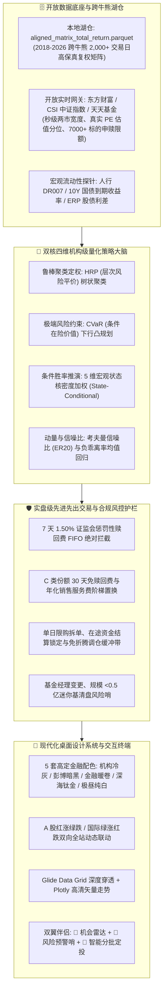

# AGY2-FundAdvisory: 全天候智能投顾与公募基金量化接管系统

[](https://www.python.org/)
[]()
[](https://streamlit.io/)
[]()
[]()
[](LICENSE)

---

## 📌 架构演进与定位声明

**AGY2-FundAdvisory** 是一款专为场外公募基金与全市场 ETF 打造的**现代化、纯开源、跨平台量化投顾与全自动组合接管桌面终端**。

> **关于商业终端（如 Wind 专网）的脱敏与自主可控演进**：
> 本系统早期曾作为辅助脚本探索特定商业内网协议，但受限于商业金融终端的专网 IP 绑定、单机进程锁死与商业凭据封禁风险。当前版本（v2.0+）已**100% 彻底脱离对万得 (Wind) 终端或任何商业专网的依赖**，全面重构为**基于纯开源免密高频行情感知、自主离线量化湖仓（Parquet 列存）与机构级全天候量化定权引擎的独立生产级系统**。

---

## ⚡ 核心能力与五大架构支柱



### 1. 纯开源免密数据底座与高保真湖仓
- **本地高保真湖仓**：内置 `data/aligned_matrix_total_return.parquet`，收录全市场核心公募基金与宽基指数在 2018-2026 年（近 2,000 个交易日）的跨牛熊累计净值复权矩阵；
- **全市场实时行情感知**：集成东方财富全市场盘中实时量能与涨跌宽度（上涨/平盘/下跌家数与总成交额），杜绝静态假常数；
- **真实 PE-TTM 估值分位引擎**：基于 CSI 中证指数与历史数据动态计算分位数，精准捕捉全市场指数低估/适中/高估状态；
- **全市场申购限额与排雷缓存**：本地缓存 7,000+ 标的申购限额（Parquet，读取延迟仅 14ms），自动穿透基金规模（AUM < 0.5 亿清盘线）、基金经理任职期回报与季度持仓。

### 2. 双核四维机构级量化策略大脑
- **层次风险平价 (HRP)**：采用无监督层次聚类与准对角化矩阵算法，突破传统 Markowitz 均值-方差对协方差矩阵求逆的病态不稳定性，在黑天鹅事件下保持极佳的配置鲁棒性；
- **下行极值风险控制 (CVaR)**：将条件在险价值（CVaR 95%）作为硬性风控优化目标，在市场暴跌周期中压低最大回撤；
- **当下时点条件胜率 ($T_{\text{now}}$ State-Conditional Win Rate)**：绝不采用后视镜式的全局历史均值，而是将当前宏观与微观 5 维状态向量：
  $$\mathbf{x}_{T_{\text{now}}} = [\text{ERP}, \text{Bias20}, \text{Mom60}, \text{EWMA\_Vol}, \text{DR007}]$$
  通过高斯核相似度赋权，输出相似市场环境下的条件胜率与滚动持有收益分布；
- **考夫曼信噪比 ($ER_{20}$) 动量增强**：计算价格位移与真实波动的信噪比，自动甄别真趋势与假杂波，对高位过热超买（$\text{Bias20} > +6\%$）标的实施均值回归折价惩罚。

### 3. 实盘级先进先出交易与合规风控护栏
- **FIFO 批次与 7 天 1.50% 惩罚费绝对拦截**：对持有不满 7 天的在途与新增份额物理锁死卖出权限，从数学规划模型底层（`lower_bound = locked_shares`）杜绝触发证监会 1.50% 惩罚费；
- **C 类份额 30 天免赎回费置换**：精准监控 C 类份额买入天数，未满 30 天严禁赎回；超过 30 天后自动测算销售服务费损耗，并在反弹阻力位指导择机全额清仓；
- **免折腾调仓缓冲带 (Deadband Buffer)**：配置 $1\% \sim 5\%$ 动态容差带，权重变动微弱时不产生调仓摩擦与摩擦损耗；
- **大额限购智能拆单**：遭遇单日限购（如 1,000 元/日）标的时，自动规划分日分批建仓路径。

### 4. 全局 5 套高定金融配色与设计系统 (Design System)
- **5 套专业级金融配色**：
  - `light_slate`（🏛️ 机构冷灰 - 默认）：清透冷灰背景 `#F8FAFC` 与纯白卡片，专业机构报告质感；
  - `dark_terminal`（⚡ 彭博暗黑）：纯正深色终端 `#0F172A` 与高亮霓虹指示色，沉浸式极客体验；
  - `nordic_paper`（📜 金融暖卷）：温润护眼米黄 `#FAF8F5` 与羊皮纸表面，适合长时间研报阅读；
  - `deep_titanium`（🪐 深海钛金）：科技深青蓝 `#0A1128` 配香槟金与青空蓝高光点缀；
  - `nordic_frost`（❄️ 极昼纯白）：极简北欧高对比度设计，清晰干练。
- **双向涨跌色彩体系**：支持 **A 股红涨绿跌** 与 **国际绿涨红跌** 一键无缝全局切换，联动全站文字、胶囊徽章与 Plotly 金融图表；
- **深色模式全穿透**：通过 Glide Data Grid 与 Streamlit 原生 CSS 变量深层注入，杜绝白块断裂与黑底黑字。

### 5. 双翼领航伴侣与分批建仓定投算子
- **🔭 全市场机会雷达**：覆盖 14 大主流核心赛道，基于信噪比、均线动量、估值分位综合打分，推荐高性价比标的并支持一键纳入备选池；
- **🚨 主动风险预警哨**：全天候巡检持仓天数、赛道超买、迷你基金清盘排雷与大盘攻防线；
- **🌊 分批建仓与智能定投算子**：支持一次性建仓、稳健三步分批（50%/30%/20% 资金严格守恒）、估值自适应智能定投（$0.5\times \sim 2.0\times$ 动态加权乘数与排期日历）。

---

## 📂 项目结构全景

```
AGY2-FundAdvisory/
├── AGY2_FundAdvisory/                 # 现代化量化投顾终端主包
│   ├── app_gui.py                     # Streamlit 桌面 GUI 入口 (设计系统/导航/看板/四核心Tab)
│   ├── strategy_bridge.py             # 投顾策略网关与状态引擎
│   ├── portfolio_manager.py           # 实盘持仓账本管理器 (FIFO批次/在途/收益穿透)
│   ├── portfolio_optimizer.py         # 核心量化算法库 (HRP/CVaR/条件胜率/Kelly)
│   ├── active_risk_sentry.py          # 主动风险预警哨引擎
│   ├── data_loader.py                 # 本地湖仓与开放高频数据加载器
│   ├── market_screener.py             # 全市场基金机会雷达与多维评分引擎
│   ├── cache_manager.py               # 盘中行情与元数据缓存治理
│   └── valuation_engine.py            # CSI 指数估值与 PE 分位数测算模块
│
├── data/                              # 数据湖仓与持久化存储
│   ├── aligned_matrix_total_return.parquet # 2018-2026 跨牛熊全天候复权收益率矩阵
│   ├── portfolio_watchdog.json        # 组合动态巡检与预警档案
│   └── cache/                         # 开放行情与限购元数据缓存
│       ├── fund_purchase.parquet      # 全市场基金申赎限额高速缓存
│       ├── index_valuation.json       # 指数真实估值与百分位分级
│       └── market_breadth.json        # 两市实时宽度与成交额
│
├── docs/                              # 系统架构白皮书与量化设计手册
│   ├── WIKI.md                        # 系统完整架构与设计百科 (量化/风控/UI/数据)
│   ├── algorithm_design.md            # HRP、CVaR、State-Conditional 算法推导
│   └── risk_control_spec.md           # 7天惩罚费、FIFO清算与合规护栏规范
│
├── scripts/                           # 自动化诊断、维护与无头服务引导
│   ├── launch_gui.bat                 # Windows 原生一键启动批处理
│   └── launch_gui.vbs                 # Windows 后台静默无窗口引导跳板
│
├── tests/                             # 自动化单元测试与回归套件
│   ├── test_infra.py                  # 基础设施与环境健康测试
│   ├── test_m3_advisory_modules.py    # 机会雷达/风险哨/分批定投单元测试
│   ├── test_dark_mode_and_deep_penetration.py # 深色模式全穿透与 UI 变量测试
│   └── test_sidebar_remodel_and_bugfixes.py   # 侧边栏与主工作区去重测试
│
├── portfolio_ledger.json              # 实盘持仓批次账本
├── pyproject.toml                     # Python 包与依赖规范
└── README.md                          # 项目使用与架构说明
```

---

## 🚀 快速启动指南

### 1. 环境准备与依赖安装
确保已安装 **Python 3.10** 或更高版本：

```bash
# 克隆仓库
git clone https://github.com/deancyl/wind-fund-advisory.git
cd wind-fund-advisory

# 安装所需核心依赖
pip install -r requirements.txt
```

### 2. 启动桌面投顾终端 (GUI)

可以通过以下任一方式启动：

#### 方式 A：标准命令行启动
```bash
streamlit run AGY2_FundAdvisory/app_gui.py
```

#### 方式 B：Windows 无黑框静默启动（推荐）
双击工作区根目录的 `launch_gui.vbs` 或 `launch_gui.bat`，系统将通过原生脱钩引导器在后台静默托管服务，并自动唤起浏览器全屏打开终端界面。

启动成功后，浏览器默认访问：
👉 **`http://localhost:8501`**

---

## 🧭 四大核心功能面板导览

| 模块 | 功能入口 | 核心价值 |
| :--- | :--- | :--- |
| **Tab 1: 资产配置与大类调优** | 🎯 全局目标联动 ➔ 资产再平衡 | 依据用户风险偏好与预期收益率，秒级推演 HRP + CVaR 机构级大类资产最优权重，输出稳健三步建仓或自适应定投排期交割单。 |
| **Tab 2: 实盘持仓与自动接管** | 💼 实盘组合账本 ➔ 自动化调仓 | 穿透展示每一笔基金的买入批次、持仓天数、在途状态与真实净值；智能计算扣除 7 天/30 天惩罚费后的安全可用赎回份额。 |
| **Tab 3: 全市场机会雷达与巡检** | 🔭 机会雷达 ➔ 🚨 风险哨 | 实时追踪 14 大赛道量化温度，推荐六维综合得分最高公募基金，一键加入备选池；实时扫描持仓潜在违约、清盘或破位风险。 |
| **Tab 4: 量化回测与压力测试** | 📈 历史推演 ➔ 极值风控 | 依托 2018-2026 跨牛熊高保真矩阵，深度回测策略在 2018 单边下跌、2019-2020 结构性牛市、2021 风格切换等极端行情下的抗风险表现。 |

---

## 🛡️ 安全合规与脱敏说明

1. **零商业凭据泄漏**：本系统遵循最高安全合规红线，代码与配置文件中严禁任何机构内部私有鉴权 Token、会话 Cookie 或内部业务网关 IP；
2. **纯本地离线优先**：持仓明细与交易批次存储于本地 `portfolio_ledger.json`，不会向任何外部不可信云端上传您的个人资产数据；
3. **免责声明**：本系统提供之量化模型、历史胜率推演与组合调仓建议仅作为辅助投研参考工具，不构成任何法律意义上的投资邀约或保本承诺。市场有风险，投资需谨慎。

---

## 📄 开源许可证

本项目基于 [MIT License](LICENSE) 开源发布。欢迎提 Issue 与 PR 共同完善公募基金量化投顾生态！
