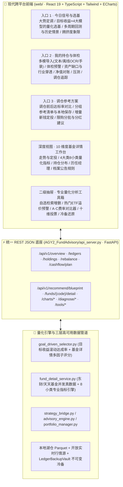

# AGY2-FundAdvisory v2.0.3 · 智能公募基金量化分析与调仓参考工作台

<p align="center">
  <strong>[ 简体中文 ]</strong> &nbsp;|&nbsp; <a href="README_EN.md"><strong>[ English ]</strong></a>
</p>

[](https://github.com/deancyl/agy2-fund-advisory/releases/tag/v2.0.3)
[](web/)
[](AGY2_FundAdvisory/api_server.py)
[](ARCHITECTURE.md)
[](#)
[](LICENSE)

---

## 📌 项目定位与 v2.0.0 里程碑

**AGY2-FundAdvisory** 是一款面向中国场外公募基金与 ETF 的**本地化、纯开源、跨平台量化分析与调仓参考工作台**。

> **核心定位声明**：本系统**纯粹提供量化模型、宏观信号、持仓体检与调仓分析参考，不连接任何券商/第三方交易接口，不执行任何实盘下单**；所有个人持仓与账本数据 100% 仅保存在用户本机。

### 🚀 v2.0.0 全新升级亮点（彻底重构现代前后端解耦架构）
1. **全新现代 Web 前端（React 19 + TypeScript + Tailwind CSS + ECharts）**：
   - 彻底告别旧版单页拥挤侧边栏与慢启动问题，首屏加载提速超 **11 倍（< 1 秒）**；
   - 采用**私人银行级深海墨蓝 + 琥珀金 + 冷雾灰三层景深视觉体系**，桌面端（`1440px`）与移动端（`390px`）全链路零溢出适配；
   - **单端口零跨域托管**：FastAPI（`127.0.0.1:8000`）一体化托管构建产物 `web/dist/` 与 `/api/v1/*` REST API，同一套前端代码可直接复用打包桌面端（Tauri `.exe`）与手机端（Capacitor `.apk`）。
2. **「目标时间区间 × 目标收益」+「基金详情多因子」量化选基与调仓闭环**：
   - 支持用户设定**目标持有周期（6个月 / 1年 / 2年 / 3年）与目标收益率（%）**，结合 4 套量化配置模型（全天候动态均衡 / 风险平价抗跌 / 高股息红利防御 / 杠铃攻守策略）与 C1~C5 风险档位，自动反推所需年化、检测风险-收益碰撞，并在 8 年真实历史净值上跑滚动窗口实算**历史达成概率**；
   - 实时并发拉取每只候选基金的真实详情量化数据（夏普、卡玛、最大回撤、年化波动率、净值新高率、信息比率、跟踪误差、规模、费率、经理稳定性），生成 **0~100 多因子量化综合得分** 并优化配置权重。
3. **全站一键钻取「10 维度基金深度详情工作台」**：
   - 点击任意推荐基金、持仓基金或调仓标的，均可进入全屏详情页，完整覆盖：
     **业绩走势图、单位/累计净值图、历史业绩表、历史净值表、自定义金额定投收益测算表、4 大类 + 8 小类量化分析指标与雷达图、持仓资产/行业/前十大重仓股、现任与历任基金经理、基金档案与产品概要、交易规则费率阶梯、最新官方公告**。
4. **工程洁净分层与全面脱敏**：
   - 5 层单向依赖 DAG（Layer-0 零依赖 `domain_models.py` + `runtime_paths.py` 跨平台数据目录隔离），全部个人持仓与账本快照均不纳入版本库，开箱纯净安全。

---

## 🏗️ 系统架构（v2.0.0 现代前后端解耦）



---

## ⚡ 快速启动指南

### 1. 环境准备
- **Python 3.10+**（建议 3.11+）
- **Node.js 20+**（仅在需要重新编译前端时使用）

```powershell
# 克隆仓库
git clone https://github.com/deancyl/agy2-fund-advisory.git
cd agy2-fund-advisory

# 安装 Python 后端依赖
py -3 -m pip install -r requirements.txt

# 编译现代 Web 前端静态产物
cd web
npm install
npm run build
cd ..
```

### 2. 一键启动（推荐）
- **Windows 无黑框桌面应用模式**：直接双击根目录 [start-agy2-web.vbs](start-agy2-web.vbs)，自动静默拉起 `127.0.0.1:8000` 并以 Edge 独立应用窗口打开。
- **命令行启动**：
  ```powershell
  py -3 -m uvicorn api_server:app --app-dir AGY2_FundAdvisory --host 127.0.0.1 --port 8000
  ```
  浏览器访问 `http://127.0.0.1:8000/` 即可使用（OpenAPI 文档位于 `http://127.0.0.1:8000/docs`）。

### 3. 前后端开发热更新模式
```powershell
# 终端 1：启动 FastAPI 后端
py -3 -m uvicorn api_server:app --app-dir AGY2_FundAdvisory --host 127.0.0.1 --port 8000

# 终端 2：启动 Vite 前端热更新（自动代理 /api -> 127.0.0.1:8000）
cd web && npm run dev
```

---

## 🧪 质量门禁与自动化测试

```powershell
# 1. 核心基础设施与 FastAPI 解耦回归测试
py -3 -m pytest -q tests/test_infra.py tests/test_api_server_decoupled.py

# 2. 六维全链路端到端实测（功能 / 视觉 / 操作 / 性能 / 准确性 / Cookie安全）
py -3 scripts/verify_route1_web_six_dim.py
```

---

## 📂 核心目录结构

```text
agy2-fund-advisory/
├── web/                              # v2.0.0 现代前端 (React 19 + TS + Tailwind + ECharts)
│   ├── src/api/client.ts             # 强类型 REST API 客户端
│   ├── src/pages/                    # SignalPage / HoldingsPage / RebalancePage / FundDetailPage
│   └── src/components/               # TopBar / ImportModal / ProAnalysisDrawer / charts/*
├── AGY2_FundAdvisory/                # Python 量化后端与 FastAPI 服务
│   ├── api_server.py                 # 统一 /api/v1/* REST 接口与单端口静态托管
│   ├── goal_driven_selector.py       # 目标收益×周期×基金详情多因子量化决策引擎
│   ├── fund_detail_service.py        # 10 维度基金深度详情并发服务与指标计算
│   ├── domain_models.py              # Layer-0 零依赖领域模型
│   ├── strategy_bridge.py            # 宏观信号、跨周期回测与资产定权大脑
│   ├── portfolio_manager.py          # 持仓估值、调仓、多账本与风险穿透
│   └── advisory_engine.py            # 十二维主动风控哨与十维量化投票
├── docs/openapi_v1.json              # 前后端统一 OpenAPI 契约
├── start-agy2-web.vbs                # Windows 一键无黑框启动器
├── ARCHITECTURE.md                   # 5 层单向依赖架构文档
└── CHANGELOG.md                      # 版本演进日志
```

---

## ⚠️ 免责声明与隐私说明

- 本项目为开源量化投研与个人组合分析工具，所有模型信号、回测结果与调仓方案**仅供学习与量化研究参考，不构成任何投资建议，亦不保证未来收益**。
- 本仓库已做全面隐私脱敏处理，**不包含任何个人真实持仓账本或截图**；首次运行可在页面右上角新建空白账本并通过文本粘贴、本地离线 OCR 或手动录入导入自己的数据，全部数据仅存储于本机。
