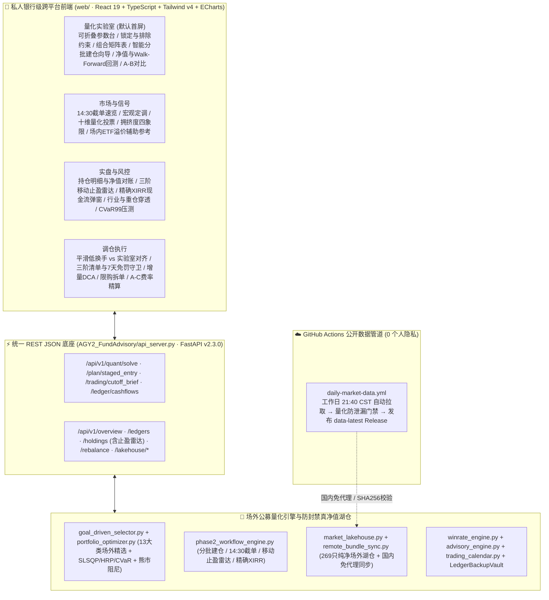

# AGY2-FundAdvisory v2.3.0 · 中国场外公募基金量化投研与止盈调仓工作台

<p align="center">
  <strong>[ 简体中文 ]</strong> &nbsp;|&nbsp; <a href="README_EN.md"><strong>[ English ]</strong></a>
</p>

[](https://github.com/deancyl/agy2-fund-advisory/releases/tag/v2.3.0)
[](https://github.com/deancyl/agy2-fund-advisory/actions/workflows/ci-quality-gate.yml)
[](https://github.com/deancyl/agy2-fund-advisory/releases/tag/data-latest)
[](web/)
[](AGY2_FundAdvisory/api_server.py)
[](LICENSE)

---

## 📌 项目定位与演进里程碑

**AGY2-FundAdvisory** 是一款面向**中国场外公募基金投资者（银行 / 支付宝 / 天天基金等渠道）**的**本地化、纯开源、机构级量化投研、分批建仓与止盈调仓工作台**。

> **核心定位声明**：本系统**纯粹提供量化模型、宏观信号、持仓体检、止盈风控与调仓执行参考，不连接任何银行/券商/第三方交易接口，不执行任何实盘下单**；所有个人持仓账本与资金流水 100% 仅保存在用户本机。

### 🚀 v2.2.0 → v2.3.0 核心升级亮点（赚钱能力 × 保收益闭环 × 制度化视觉）

1. **中国场外公募真净值底座与样本外防作弊加固（Phase 1 · `v2.2.0`）**：
   - **100% 场外可买清单**：建立 `fund_catalog.parquet` 与 `fund_trading_rules.parquet` 权威主数据，13 大类精细分类（新增独立 `short_bond` 短债盾），自动剔除锁定期/持有期封闭基、仅场内 ETF、挂羊头卖狗肉伪海外/伪黄金基金，全链路绝不向场外买家推荐场内 ETF 代码；
   - **严格 70/30 样本外 + 真 Walk-Forward 滚动盲测**：杜绝未来函数与过拟合，核心量化引擎与宏观择时内核完全对齐，新增熊市左尾降仓阻尼与 A/C 类份额真实申赎费率映射；
   - **GitHub Actions 云端每日公开数据包**：每日盘后自动跑数、过量化防泄漏门禁并发布 `data-latest` Release（含桌面全量包与移动端紧凑二进制包），内置国内免代理加速拉取与 SHA256 校验。
2. **「能赚钱 + 守住胜利果实」场外实操闭环（Phase 2 · `v2.3.0`）**：
   - **智能分批建仓向导（`POST /api/v1/plan/staged_entry`）**：输入计划投入金额与市场体感，自动结合当前宏观温度与估值位置生成 3~6 期分批建仓节奏、每期触发条件与单只基金分配金额，支持原生日历/清单化参考；
   - **14:30 截单速览条（`GET /api/v1/trading/cutoff_brief`）**：贴合中国公募基金 T 日 15:00 申赎截单规则，在 14:30 黄金窗口一目了然呈现当日市场定调、待执行买/卖动作、7 天免罚赎回红线与 T+1/T+2 确认日历；
   - **持仓级三阶移动止盈雷达**：在实盘与风控页为每只持仓自动追踪「浮盈达标 → 高点回撤预警 → 分批落袋建议」三阶状态，专治基金“坐过山车”回吐利润；
   - **精确 XIRR 资金加权年化收益与私有流水账本**：支持按账本独立维护申购/赎回/分红现金流（`data/cashflows_*.json` 本地私有、严禁入库），通过牛顿法精确计算个人真实 XIRR；
   - **样本外前瞻审计面板**：实时记录并核验历史推荐方案在真实样本外走势中的表现，拒绝事后美化。
3. **私人银行级制度化 WebUI 视觉打磨（`v2.3.0`）**：
   - 统一温润宣纸蓝灰画布（`#F4F7FB`）、无单位行高、`rem` 自适应流式 KPI 字号、`color-mix(in oklab, ...)` 语义高亮与原生 `<dialog>` 弹窗规范；
   - 量化实验室矩阵表 `1440px` 零横向滚动条，移动端 `390px` 零页面级溢出，ECharts 拥挤度四象限与双轴图零标签重叠。

---

## 🏗️ 系统架构（v2.3.0 前后端解耦 + 云端日更数据管道）



---

## ⚡ 快速启动指南

### 1. 环境准备
- **Python 3.10+**（建议 3.11+）
- **Node.js 20+**（仅在需要重新编译前端时使用）

```powershell
# 克隆仓库
git clone https://github.com/deancyl/agy2-fund-advisory.git
cd agy2-fund-advisory

# 安装 Python 后端依赖
py -3 -m pip install -r requirements.txt

# 编译现代 Web 前端静态产物
cd web
npm install
npm run build
cd ..
```

### 2. 一键启动（推荐）
- **Windows 无黑框桌面应用模式**：直接双击根目录 [start-agy2-web.vbs](start-agy2-web.vbs)，自动静默拉起 `127.0.0.1:8000` 并以 Edge 独立应用窗口打开。
- **命令行启动**：
  ```powershell
  py -3 -m uvicorn api_server:app --app-dir AGY2_FundAdvisory --host 127.0.0.1 --port 8000
  ```
  浏览器访问 `http://127.0.0.1:8000/` 即可使用（OpenAPI 文档位于 `http://127.0.0.1:8000/docs`）。

### 3. Docker 一键容器化部署与安全升级（推荐 NAS / 服务器）
仓库内置多阶段构建 [Dockerfile](Dockerfile) 与 [docker-compose.yml](docker-compose.yml)，并将随仓公开市场基准种子与主数据目录（`data/master/*`、`data/processed/*`、`data/macro/*`、`data/mart/*`）预置到镜像只读目录 `/app/seed_data`（`AGY2_SEED_DIR=/app/seed_data`）：

```bash
# 首次部署或拉取新版升级（自动按需补齐公开基线种子，绝不覆盖宿主机个人账本与流水）
AGY2_HOST_PORT=8000 docker compose up -d --build
```

> **增量源码包升级提示**：若使用 `tar` 解压覆盖既有部署目录，请**仅排除个人私有账本、流水与备份**（如 `--exclude="data/ledgers*" --exclude="data/cashflows_*.json" --exclude="data/backups*" --exclude="data/cache*"`），**切勿使用 `--exclude="data/*"`**。

### 4. 前后端开发热更新模式
```powershell
# 终端 1：启动 FastAPI 后端
py -3 -m uvicorn api_server:app --app-dir AGY2_FundAdvisory --host 127.0.0.1 --port 8000

# 终端 2：启动 Vite 前端热更新（自动代理 /api -> 127.0.0.1:8000）
cd web && npm run dev
```

---

## 🧪 质量门禁与自动化测试

```powershell
# 1. 全量核心量化完整性、Phase 1/2 闭环、种子自举与基础设施回归测试 (41 项)
py -3 -m pytest -q tests/test_phase2_money_making_workflow.py tests/test_phase1_quant_integrity.py tests/test_akshare_compat_and_seed_bootstrap.py tests/test_infra.py tests/test_g17_advisory_real_data_and_ten_dimension.py

# 2. 前端类型检查与生产构建验证
cd web && npm run build
```

GitHub Actions 每次推送至 `master` / `main` 会自动执行 [CI Quality & Quantitative Integrity Gate](.github/workflows/ci-quality-gate.yml)（前端构建门禁 + 后端量化防泄漏与功能闭环门禁）。

---

## 📂 核心目录结构

```text
agy2-fund-advisory/
├── web/                              # v2.3.0 私人银行级前端 (React 19 + TS + Tailwind v4 + ECharts)
│   ├── src/api/client.ts             # 强类型 REST API 客户端
│   ├── src/context/WorkbenchContext.tsx # 顶层状态保活、异步求解与 A/B 快照对比引擎
│   ├── src/pages/                    # QuantLabPage / MarketSignalPage / HoldingsPage / RebalancePage / FundDetailPage
│   └── src/components/               # TopBar / StagedEntryModal / CashflowModal / FundInspectorDrawer / DataCenterModal / CommandPalette / charts/*
├── AGY2_FundAdvisory/                # Python 量化后端与 FastAPI 服务
│   ├── api_server.py                 # 统一 /api/v1/* REST 接口 (v2.3.0) 与单端口静态托管
│   ├── phase2_workflow_engine.py     # 分批建仓向导、14:30截单、持仓三阶移动止盈与精确 XIRR 引擎
│   ├── goal_driven_selector.py       # 13大类场外公募精选、锁定/排除约束与熊市阻尼求解器
│   ├── portfolio_optimizer.py        # SLSQP/HRP/CVaR 组合优化与 A/C 费率映射
│   ├── winrate_engine.py             # 70/30 样本外 + 真 Walk-Forward 滚动盲测引擎
│   ├── market_lakehouse.py           # 269只纯净场外复权净值湖仓与防封禁增量同步
│   ├── remote_bundle_sync.py         # GitHub Release data-latest 国内免代理拉取与 SHA256 校验
│   ├── akshare_compat.py             # AkShare 1.14~1.20+ 跨版本兼容层与并发锁
│   ├── advisory_engine.py            # 十二维主动风控哨与十维量化投票
│   └── portfolio_manager.py          # 持仓估值、调仓、多账本与风险穿透
├── .github/workflows/                # CI 质量门禁 (ci-quality-gate.yml) 与每日公开数据包流水线 (daily-market-data.yml)
├── scripts/build_daily_public_bundle.py # 每日公开行情包与移动端紧凑二进制包构建器
├── start-agy2-web.vbs                # Windows 一键无黑框启动器
├── ARCHITECTURE.md                   # 5 层单向依赖架构文档
└── CHANGELOG.md                      # 版本演进日志
```

---

## ⚠️ 免责声明与隐私说明

- 本项目为开源量化投研与个人组合分析工具，所有模型信号、回测结果、止盈提醒与调仓方案**仅供学习与量化研究参考，不构成任何投资建议，亦不保证未来收益**。
- 本仓库已做全面隐私脱敏处理，**不包含任何个人真实持仓账本、现金流流水或截图**；首次运行可在页面右上角新建空白账本并通过文本粘贴、本地离线 OCR 或手动录入导入自己的数据，全部数据仅存储于本机。
