# AGY2-FundAdvisory: 全天候智能投顾与公募基金量化接管系统

<p align="center">
  <strong>[ 简体中文 ]</strong> &nbsp;|&nbsp; <a href="README_EN.md"><strong>[ English ]</strong></a>
</p>

[](https://www.python.org/)
[](https://github.com/deancyl/wind-fund-advisory/releases/tag/v1.0.7)
[](GEMINI.md)
[](https://streamlit.io/)
[]()
[]()
[]()
[]()
[]()
[-brightgreen.svg)](tests/)
[](LICENSE)

---

## 📌 架构定位与自主可控演进

**AGY2-FundAdvisory** 是一款专为中国场外公募基金与全市场 ETF 打造的**现代化、纯开源、跨平台机构级买方量化投顾与组合自动化接管桌面工作台**。

> **🌟 彻底脱离商业专网（如 Wind / Bloomberg）的自主可控宣言**：
> 本系统早期曾尝试集成商业金融专网数据源，但受限于商业客户端专网 IP 白名单封锁、单机单进程互斥锁死与封闭黑盒协议。当前 **v1.0.7 正式版本**严格遵循《工程宪法 v6.0》，已**100% 彻底脱钩对万得 (Wind) 终端或任何商业专网的依赖**，全面重构为：
> - **纯开源开放高频行情底座**（东财 Push2 / CSI 中证官方 / 天天基金多轨毫秒级互备，单次批量 HTTP 预取，秒级捕获两市量能与盘中点位）；
> - **官方净值最高主权与盘中双轨独立对账**（收盘官方清算净值 `FundMNFInfo` 校验 `>= latest_completed_trade_str` 确定最高主权；盘中实时估值与四级穿透完整归档，实现 MAE 基点级对账归因）；
> - **自主可控离线量化湖仓**（2018-2026 跨牛熊 2,000+ 交易日高保真 Parquet 复权净值矩阵，无未来函数泄漏，34 处违规硬编码常数彻底物理清零）；
> - **全栈 7 大机构级量化定权策略大脑**（鲁棒双核 HRP、全天候风险平价、BL 主客观观点融合、条件胜率最优等）；
> - **实战 29 只基金重塑账本与尾仓清扫**（真实账本 `combat_29_funds`，碎片尾仓 `< 200元` 强制清扫归拢，纯债底仓自动去重合并，科创50C 满 30 天自动触发零费率 C 转 A）；
> - **十二维主动风险预警哨兵**（锁定期阶梯防御、高水位移动止盈、深套归因、期权 IV 防暴跌对冲）；
> - **奥卡姆剃刀与三层渐进式终端**（首屏裁决台 <= 110px，横向双抽屉机会风控雷达，宽屏原生全宽逐基对账单，5 大核心图表白话导读胶囊，移动端极简 4 列响应式适配）。

---

## ⚡ 全景架构与六大核心引擎

```mermaid
flowchart TD
    subgraph DataLayer ["🗄️ 开放高保真数据底座与毫秒级批量湖仓"]
        D1["本地湖仓: aligned_matrix_total_return.parquet<br/>(2018-2026 跨牛熊 2,000+ 交易日复权矩阵，34处硬编码彻底清零)"]
        D2["单次批量行情引擎: prefetch_batch_fund_quotes<br/>(1 次 HTTP 请求获取 29 只基金，未命中多线程并发补齐，0.95s 极速全量同步)"]
        D3["官方净值 vs 实时估值双轨独立对账体系<br/>(东财 FundMNFInfo 清算最高主权 + 盘中天天/东财实时估值 + 四级穿透)"]
        D4["宏观传感器: 人行 DR007 / 10Y 国债 / ERP 风险溢价 / 50ETF认沽期权 IV"]
    end

    subgraph CoreEngine ["🧠 全栈 7 大机构级量化策略大脑 & 调仓自洽"]
        E1["鲁棒双核 HRP: 层次聚类 + 极值 CVaR 下行风险凸优化"]
        E2["核心-卫星杠铃: 70%~80% 核心底仓安心吃息 + 20%~30% 卫星抓超额"]
        E3["全天候风险平价: 跨资产风险边际贡献平衡 (Risk Parity)，不预测牛熊"]
        E4["BL 主客观观点融合: Black-Litterman 贝叶斯后验 + 机会雷达主线先验"]
        E5["条件胜率最优: 同温层宏观 5 维状态核密度加权 (State-Conditional)"]
        E6["实战 29 只基金重塑引擎: combat_29_funds 碎片尾仓强制清扫 + 纯债去重合并"]
        E7["因果律样本外回测: 严格前一日特征切片点乘 w_opt，扣除双边换手摩擦"]
    end

    subgraph RiskGuard ["🛡️ 十二维主动风险预警哨 (ActiveRiskSentry 12D)"]
        R1["① 7 天 1.50% 证监会惩罚费 FIFO 批次悲观硬拦截 (锁死调仓下界)"]
        R2["② 临免赎倒计时保护与持有期阶梯精算"]
        R3["③ C 类份额 30 天免赎期置换 A 类与费率阶梯预警 (011613 -> 011612)"]
        R4["④ 右侧破位与高水位移动止盈 (Bias20 脉冲阶梯止盈锁利)"]
        R5["⑤ 超买拥挤与均值回归惩罚折价"]
        R6["⑥ 浮亏深套标的 (-12%) 赛道 Beta 错杀 vs 经理 Alpha 恶化诊断"]
        R7["⑦ 赛道集中度 (>35%) 与单一基金管理人敞口超限警报"]
        R8["⑧ 基金规模 <0.5 亿迷你基清盘警戒线与四级穿透验真"]
        R9["⑨ 沪深 300 变盘攻防线实时哨兵"]
        R10["⑩ 动态相关性突变防御: 顺周期急跌且红利与高Beta相关性 >0.80 避险平移"]
        R11["⑪ 投资者适当性 (C1~C5) 风险档位匹配与高波科技一键降波"]
        R12["⑫ 50ETF/300ETF 认沽期权 IV 突升 30% 防暴跌警报与纯债增配"]
    end

    subgraph ExecutionEngine ["⚡ 微观执行、衍生品套利与资金会计守恒"]
        EX1["动态微观滑点精算: calculate_vwap_execution_slippage (尾盘买入节省 bps)"]
        EX2["场内 ETF 与场外联接 14:45 尾盘折溢价套利感知 (IOPV 实时测算)"]
        EX3["跨境 QDII 溢价与外汇期货掉期点锁汇成本套利精算 (到手净收益 bps)"]
        EX4["同基金公司内部免赎极速转换策略 (0 在途时滞，免申购费与利息摩擦)"]
        EX5["大额定投跨 3 至 5 交易日波动率自适应平抑建仓挂单调度"]
        EX6["在途买单与转换单资产守恒会计 (彻底消除调仓净值假暴跌与假回撤)"]
    end

    subgraph UIEngine ["🎨 奥卡姆剃刀与三层渐进式机构终端 (3-Tier UI)"]
        U1["第一层: 首屏直显裁决台 (<=110px, 1行核心结论+仓位因果公式+5颗人话胶囊)"]
        U2["第二层: 默认折叠双横向抽屉 (Top 3 机会雷达与主动风控哨 / 十维投顾与拐点对照尺)"]
        U3["第三层: 四大主工作台首屏直出 (宽屏原生全宽逐基对账单 expander + 指标摘要)"]
        U4["五大深度图表白话导读胶囊 (💡怎么看 + 🎯行动信号，零遮挡透明图例)"]
        U5["多模智能建仓: 截图切片 OCR 识别 (置信度安全预警) + 批量自然文本智能解析"]
        U6["双视口响应式设计: 移动端 (?view=mobile) 4 列极简决策表与 2x2 指标网格"]
    end

    DataLayer --> CoreEngine
    CoreEngine --> RiskGuard
    RiskGuard --> ExecutionEngine
    ExecutionEngine --> UIEngine
```



---

## 🌟 四大业务工作区核心功能

### 1. 🌱 新资建仓 (New Capital Onboarding)
* **开箱即用与首屏秒开**：首次打开软件无下半屏空白，10ms 内基于预热缓存直接渲染 10 万元 C3 平衡型默认建仓方案与核心指标条；
* **单行 5 列绝对等高控制栏**：拟投资总本金、风险策略档位（C1~C5）、建仓节奏（一次性建仓/定期定额/波动率自适应分批）、高级参数浮层与「⚡ 生成实盘建仓方案」主按钮在同一水平线上像素级对齐；
* **全息漏斗选基与 OCR 多模录入**：支持真实持仓截图切片 OCR 自动识别、批量自然文本智能解析，录入表配匹配置信度，`<0.85` 显式标黄提示人工复核；
* **三大置顶指标条**：同屏直观展示「收益与胜率（1年达标胜率与票息安全垫）」、「风险底线（历史极端浮亏与水下回本周期）」、「攻防定权（防守/进攻仓位比与第一重仓标的）」；
* **9 列实盘建仓执行大表**：精准买入金额、目标占比进度条、风险贡献 (PCR %)、排雷与拥挤度健康徽章、实操分红与限购拆单指引；
* **白盒量化抽屉**：一键展开查看层次聚类树状图、协方差热力图、跨牛熊滚动达标胜率表与 10,000 次蒙特卡洛极端压力测试。

### 2. 💼 持仓调仓与实战重塑 (Portfolio Rebalance & Combat Execution)
* **真实 29 只基金实战组合接管**：内置 `combat_29_funds` 真实战役账本，完整覆盖 29 只基金的真实成本、份额与盈亏事实；
* **碎片尾仓（< 200元）强制清扫归拢**：凡已满 7 天免罚期的碎片尾仓（共 19 只），目标权重强制置零，操作锁定为「🧹 建议清仓归拢」，杜绝逆向加仓；
* **同赛道纯债底仓自动去重合并**：拥有核心纯债主锚（`002351` 易方达裕祥回报）时，自动将策略池同属性纯债（`000086`）的目标权重全额合并至 `002351`，杜绝凭空新买冗余纯债；
* **核心持仓与尾仓语义隔离**：市值 `>= 500元` 的底仓调整严格标记为「➖ 建议减仓」，杜绝在数千元核心持仓上误贴“清扫碎片”标签；
* **科创50C 满 30 天自动触发 C 转 A**：持有满 30 天免赎期自动触发零费率置换入 `011612`（科创50A）；
* **宽屏逐基对账单全景展开**：脱离狭小 Popover，迁入原生全宽 `st.expander`，外置「官方净值已公布 (26/29只)」、「官方vs估算 MAE (0.21%)」、「双源平均分歧 (0.15%)」与「4位修约准则」四大指标卡；
* **极速刷新与数据守恒**：调用东财 `FundMNFInfo` 批量接口，29 只基金在 0.95 秒内完成全量刷新与对账。

### 3. 📈 组合回测与因果律还原 (Portfolio Backtest)
* **全生态 Plotly 换肤与零遮挡图层**：图例背景纯透明且上浮至绘图区外部上方，顶部预留安全边距，彻底杜绝遮挡 2024~2026 年关键曲线；
* **五大深度图表两行白话导读**：在回撤、大类演进、赛道相关性、月度热力图与风险收益四象限图正上方，统一配置 `💡 怎么看` 与 `🎯 行动信号` 双行白话导读；
* **真实全收益日度基准对齐**：纯债基准强制绑定中证综合债全收益指数 `H11009` 真实日度收盘序列；红利低波锁定 `H30269` 真实全收益；
* **全流程反造假与因果律还原**：彻底清除人为合成 Alpha 与伪随机噪声，样本外滚动推演每日基于 $d-1$ 日特征点乘演化权重 $w_{\text{opt}}$ 选出 Top 3 赛道，并严格扣除双边 20 bps 换手摩擦成本；
* **后视镜偏差警示与 C3 动态标杆对比**：静态持仓回溯上方醒目揭露幸存者效应警示卡，支持一键同屏叠加大全天候滚动样本外动态策略 (C3) 标杆基准线。

### 4. 🔍 穿透工具箱 (Look-Through Toolbox)
* **二级选项卡扁平化架构**：彻底清除二级 Tab 内同名 `st.expander` 套娃，直出内容；
* **大类资产穿透与排雷**：穿透前十大重仓股与底层纯债/现金真实比例，杜绝“稳健混合”假面具；
* **14 大赛道量化温度计**：4 小时磁盘持久化读写闭环，全息展现赛道估值分位、趋势信噪比、20日乖离率与拥挤度；
* **场内 ETF 与场外联接 14:45 尾盘折溢价套利感知**：实时监测黄金、沪深300、科创50、芯片、标普500、恒生科技二级市场市价与实时 IOPV，溢价 $>+1.0\%$ 提示场外低成本申购联接基金避开泡沫，折价 $<-1.0\%$ 提示场内折价低吸；
* **50ETF 与 300ETF 认沽期权隐含波动率防暴跌哨**：实时监控认沽期权 IV 与 20 日 HV 偏离度，当 IV 突升超 30% 且大盘跌破 MA20 时输出红色防暴跌预警，指导增配纯债；
* **跨境 QDII 溢价与外汇期货锁汇成本套利精算**：结合离岸人民币 (USD/CNH) 远期掉期点精算年化锁汇成本与到手净收益增厚基点 (bps)；
* **A/C 份额费率与盈亏平衡精算器**：局部无感刷新精算持有期限平衡临界天数。

---

## 🛡️ 十二维主动风险预警哨兵 (ActiveRiskSentry 12D)

系统内置买方风控最高防线，在持仓变动时秒级执行 12 维全面穿透巡检：

| 维度 | 风控规则名称 | 触发阈值与模型逻辑 | 买方投顾处置意图与实操指引 |
| :---: | :--- | :--- | :--- |
| **D1** | **未满 7 天惩罚费硬防线** | 持仓批次天数 $<7$ 天，触发 1.50% 证监会惩罚费 | 锁死调仓下界（`lower_bound = locked_shares`），物理严禁卖出 |
| **D2** | **临免赎倒计时保护** | 持有期处于 5~6 天临界窗口 | 提示“倒计时 1~2 天”，暂缓赎回，避免无谓扣费 |
| **D3** | **C 类份额 30 天阶梯免除** | C 类份额持有期 $\ge 30$ 天免赎期已满 | 建议在技术面反弹时择机全额置换为优质 A 类底仓或无费率标的 |
| **D4** | **右侧破位与移动止盈** | 标的高位脉冲且 20 日均线乖离率 $\text{Bias}_{20} > 6.0\%$ | 输出 `TAKE_PROFIT` 移动止盈信号，阶梯落袋 40% 锁定利润 |
| **D5** | **超买拥挤与均值回归** | 赛道拥挤度评分 $>85$ 分且连续暴涨 | 实施均值回归折价惩罚，禁止在结构性泡沫高位追高申购 |
| **D6** | **深度套牢病根归因诊断** | 累计浮亏超过 $-12.0\%$ | 区分赛道行业 Beta 错杀（耐心卧倒）与经理 Alpha 恶化（反抽割肉） |
| **D7** | **赛道与管理人集中度** | 单一基金公司或高波科技赛道市值敞口 $>35.0\%$ | 触发黄色预警，指导资金定向平移至非同系头部公募或防御性固收 |
| **D8** | **迷你基清盘排雷哨** | 基金最新合并 AUM 规模 $<0.5$ 亿元 | 发出红色清盘退市警报，执行调仓时列为第一优先级清理标的 |
| **D9** | **沪深 300 变盘攻防线** | 大盘跌破 60 日牛熊生命线或突破重要阻力位 | 输出防御收缩至纯债底仓，或突破后适度进取加仓指令 |
| **D10**| **动态相关性突变防御** | 顺周期急跌且红利与高 Beta 相关系数 $>0.80$ | 触发跨资产避险平移预案，将超额敞口阶梯削减并平移至纯债与黄金 |
| **D11**| **投资者适当性梯度护栏** | 组合风险与用户 C1~C5 承受能力失配 | 强制权益仓位上限梯度，超标时建议一键降波至合规安全水位 |
| **D12**| **期权 IV 突升防暴跌哨**| 认沽期权 IV 相对 HV 突升超 30% 且跌破 MA20 | 输出红色防暴跌预警，指导买方组合立即增配纯债（如 002351）避险 |

---

## 📊 全栈 7 大机构级量化定权模型

系统根据宏观同温层状态向量 $\mathbf{x} = [\text{ERP}, \text{Bias}_{20}, \text{DR007}, \text{iVIX}]$ 智能推荐最优定权模型：

```
1. 鲁棒双核 HRP (Hierarchical Risk Parity):
   无监督层次树状聚类隔离资产踩踏，结合尾部 CVaR 规划，实现结构分化与震荡市稳健收益。

2. 核心-卫星杠铃策略 (Core-Satellite Barbell):
   70%~80% 核心固收与低波红利底仓安心吃息 + 20%~30% 高弹性卫星赛道抓取超额 Alpha。

3. 全天候风险平价 (All-Weather Risk Parity):
   跨资产风险边际贡献平价 (Equal Risk Contribution)，四象限全周期均衡，不依赖牛熊预测。

4. BL 主客观观点融合 (Black-Litterman):
   以市场中性均衡为基准，注入 14 赛道机会雷达微观信噪比先验，通过贝叶斯定理更新后验权重。

5. 条件胜率最优 (State-Conditional Win Rate):
   基于高斯核状态机相似度匹配历史同温层宏观环境，定向优选与配置当前时点条件胜率最高的标的。

6. 尾部风控 CVaR (Conditional Value-at-Risk):
   凸优化最小化条件在险价值，深度压低极端黑天鹅肥尾损失，防范长期严重深套。

7. 凯利动量增强 (Half-Kelly Momentum):
   连续半凯利公式结合考夫曼自适应信噪比 (ER20)，高信噪比时果断跟进主升浪，衰竭时迅速减速。
```

---

## 🚀 快速开始与部署指引

### 1. 环境准备
推荐使用 Python 3.10 或 3.11 环境：
```bash
git clone https://github.com/deancyl/wind-fund-advisory.git
cd wind-fund-advisory
pip install -r requirements.txt
```

### 2. 一键启动投顾桌面终端
```bash
streamlit run AGY2_FundAdvisory/app_gui.py --server.port 8501
```
启动后在浏览器中打开 `http://localhost:8501`，即可享受 **0.95 秒极速秒开、首屏裁决台、双轨对账与实战 29 只基金重塑工作台**！
移动端适配视口访问：`http://localhost:8501/?view=mobile`。

### 3. 执行全量自动化测试与工程门禁
```bash
# 1. 运行 G28 生产级清理与债务根治门禁
python scripts/verify_g28_production_readiness.py
python scripts/verify_g28_clean_debt_gate.py

# 2. 运行四大裁判文件只读哈希锁定校验
python scripts/verify_readonly_hashes.py

# 3. 运行 G27/G26/G25 历史回归与双轨对账门禁
python scripts/verify_g27_anticheat_and_routing_gate.py
python scripts/verify_g26_valuation_vs_official_reconciliation.py
python scripts/verify_g25_realtime_and_consistency.py

# 4. 运行 Pytest 核心测试套件
pytest tests/test_infra.py tests/test_adversarial_m3_combat29_challenger.py -v
```
运行结果确保**各项门禁 100% 绿灯全过**，四大只读裁判文件 SHA256 哈希 0 篡改。

---

## 📝 版本更新历史 (Changelog)

### [v1.0.7] - 2026-11-19
- **最高核心：全面服从《工程宪法 v6.0》与真数据零造假铁律**：
  * **34 处违规硬编码常数物理清零**：全面删除汇率（`7.2385`）、中债（`4.4200`）与红利低波基准（`11569.50`），接入列存湖仓真实截面，严禁伪造数字；
  * **官方收盘净值最高主权 (Official NAV Supremacy)**：基于交易日历校验净值日期 `>= latest_completed_trade_str` 确定官方净值，一旦公布立即采信官方涨跌幅，严禁后置算法二次覆盖；
  * **盘中实时估值与官方净值双轨独立对账体系**：盘中采信官方实时估值（`GSZZL`），四级穿透兜底；晚间归档估算值输出逐基 MAE 误差分析与归因解释；
  * **4 位净值修约与 C 类日费精算**：计算涨跌幅时严格使用 4 位小数净值修约（如 `0.9343`），并扣除 C 类销售服务费日均成本；
  * **联接基金动态 Beta 与元数据修复**：修复判定死代码，增加 `fund_name` 参数与对齐矩阵内存缓存，纠偏二级债基 `018757` 元数据单一真源；
  * **凌晨非交易时段防写脏**：锁定 `00:00~09:34` 禁止写脏归档文件，盘中仅归档有效估算。
- **实战 29 只基金重塑账本与调仓自洽**：
  * **真实资产组合全面接管**：正式实装 `combat_29_funds` 实战账本，完全覆盖投资者 29 只基金真实资产事实；
  * **碎片尾仓（< 200元）强制清扫归拢**：已满 7 天免罚期的碎片尾仓（共 19 只）调仓目标权重强制置零，操作锁定为「🧹 建议清仓归拢」，杜绝逆向追买；
  * **同赛道纯债底仓自动去重合并**：拥有核心纯债主锚（`002351`）时，自动将策略池同属性纯债（`000086`）的目标权重全额合并至 `002351`，杜绝凭空开仓买入冗余纯债；
  * **核心持仓与尾仓语义严格隔离**：市值 `>= 500元` 的底仓调整严格标记为「➖ 建议减仓」，杜绝在数千元核心持仓上误贴“清扫碎片”标签；
  * **科创50C 满 30 天自动触发 C 转 A**：持有满 30 天免赎期自动触发零费率置换入 `011612`（科创50A）。
- **极致性能突破：单次批量请求与秒级湖仓极速刷新**：
  * **单次 HTTP 批量拉取 (`prefetch_batch_fund_quotes`)**：利用东财 `FundMNFInfo` 的 `Fcodes` 能力在 1 次 HTTP 请求（<0.3s）内获取 29 只基金行情，未命中项多线程并发补齐，批次结束仅执行 1 次磁盘写入；
  * **全组合秒级极速刷新**：29 只基金全量行情拉取、净值同步与盘中盈亏对账总耗时压缩至 **0.95 秒**，彻底根除 N+1 串行网络瓶颈；
  * **盘中刷新剥离低频爬虫**：盘中极速刷新剥离历史 PE 网页爬虫，十年估值分位数全走本地列存湖仓。
- **奥卡姆剃刀与三层渐进式终端**：
  * **第一层（首屏直显裁决台，<= 110px）**：1 行核心结论 + 仓位因果传导公式 + 5 颗精炼人话胶囊（<= 20 字），普通投资者 3 秒掌握今日定调；
  * **第二层（默认折叠横向双抽屉）**：「🔭 Top 3 机会雷达与主动风控哨」和「🧭 十维投顾量化投票与拐点对照尺」，风控哨精准绑定当前持仓；
  * **第三层（四大工作台核心）**：宽屏逐基对账单 expander，外置指标卡（官方已出只数、MAE、双源分歧、4位修约准则）；五大核心图表顶部两行白话导读胶囊（💡怎么看 + 🎯行动信号）；
  * **响应式双视口自适应**：移动端（`?view=mobile`）自动切换 4 列极简决策表与 2×2 指标网格，消除横向滚动条，根除 `ValueError` 解构与列名重复异常；
  * **生产级环境纯净化**：物理删除 `btn_mock_pending_order` 模拟假按钮，确保系统纯粹面向买方实战。
- **智能 OCR 截图切片识别与多模检索增强**：
  * 支持持仓截图自动切片 OCR 识别与批量自然文本智能解析入库；
  * 导入预览表增设「原图识别名」与「匹配置信度」，`<0.85` 显式标黄复核；
  * 多模代码/拼音/中文快速定标（支持拼音缩写 `hldb`、中文 `红利低波`、指数代码 `H30269` 极速定位）。

### [v1.0.6] - 2026-11-09
- 四大隐蔽代码漏洞彻底封堵（雷达 4 小时磁盘读写闭环、12 维风控哈希缓存直读、样本外动态多因子打分因果律还原、清理伪交易待办横幅）；
- 统一高定机构蓝主按钮与 Plotly 全局透明浮动图例；
- 5 组核心测试套件共 55 项用例 100% 绿灯全过。

### [v1.0.5] - 2026-11-08
- 多资产相关性突变防御（Ang & Chen 2002 动态突变模型）；
- 10,000 次时间序列块重采样极限承压测试（Circular Block Bootstrap CVaR 99%）；
- 场外公募重仓 ADV/AUM 非线性流动性冲击折价模型与 Brinson-Fachler 经典超额三维归因闭环。

---

## 📄 开源许可证

本项目基于 [MIT License](LICENSE) 开源发布。
欢迎提交 Issue 与 Pull Request，共同建设纯开源、自主可控、严谨科学的中国公募基金买方量化投顾生态！
