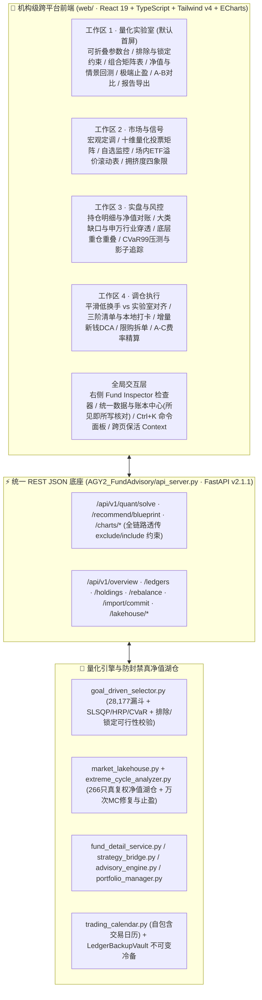

# AGY2-FundAdvisory v2.1.1 · 机构级公募基金量化投研与调仓参考工作台

<p align="center">
  <strong>[ 简体中文 ]</strong> &nbsp;|&nbsp; <a href="README_EN.md"><strong>[ English ]</strong></a>
</p>

[](https://github.com/deancyl/agy2-fund-advisory/releases/tag/v2.1.1)
[](web/)
[](AGY2_FundAdvisory/api_server.py)
[](ARCHITECTURE.md)
[](#)
[](LICENSE)

---

## 📌 项目定位与 v2.1.0 机构级工作台里程碑

**AGY2-FundAdvisory** 是一款面向中国场外公募基金与 ETF 的**本地化、纯开源、跨平台机构级量化投研与调仓参考工作台**。

> **核心定位声明**：本系统**纯粹提供量化模型、宏观信号、持仓体检与调仓分析参考，不连接任何券商/第三方交易接口，不执行任何实盘下单**；所有个人持仓与账本数据 100% 仅保存在用户本机。

### 🚀 v2.1.0 核心升级亮点（机构级投研工作台重构）
1. **全新「宽屏顶栏 × 实验室可折叠分栏 × 4 大互斥工作区」信息架构**：
   - `48px` 极简深海墨蓝顶栏 + `34px` 实盘状态 Ticker 带（实时呈现宏观定调、沪深300/科创50/中证红利与真净值湖仓同步态），告别长瀑布流与窄侧边栏堆砌；
   - **量化实验室（默认首屏）**：支持可折叠左侧参数控制台与 4 个单屏下划线子视图（`组合方案矩阵` / `净值与情景回测` / `极端周期与止盈` / `A/B 方案对比`），折叠侧栏即享 100% 满宽图表视野；
   - **市场与信号 / 实盘与风控 / 调仓执行**三大宽屏工作区职责完全隔离，原抽屉中的十维量化投票矩阵、ETF 溢价预警（吸顶滚动表）、底层重仓股重叠穿透、A/C 类份额费率精算器全部按专业投研工作流正式归位。
2. **可操控量化沙盒与 A/B 公平对比**：
   - 组合配置矩阵表内置真实 `MA20乖离/短线温度`、风险贡献 `PCR` 与行内一键 **「锁定必选 / 排除重算」**，排除与锁定约束全链路贯通求解器、缓存、净值回测、历史情景与调仓对齐（零幽灵复活），并内置 C 档大类冲突校验与 `index_only` 自动解绑主动锁；
   - 支持最多 4 组方案快照持久化至 `localStorage` 并排对比（强制对齐「近 1 年 + 全周期」双口径 + 湖仓截止日过期检测 + 标的权重 & PCR 横向 Diff），支持一键导出 **Markdown 投研报告** 与 **JSON**；
   - 全站核心量化指标统一配备 `?` **专业口径审计浮卡**（公式、窗口、数据源、假设），全面清除彩虹渐变 KPI 与常驻新手读图框。
3. **无跳页基金检查器、统一数据中心与 `Ctrl/Cmd + K` 全局命令面板**：
   - 点击全站任意基金从右侧滑出 `520px` **Fund Inspector 检查器**（展示配权公式推导、精准近 1 年收益曲线、阶段业绩、十大重仓与一键排除/锁定，不丢页面状态），支持一键展开全屏 5 维档案；
   - 顶栏「数据与账本」统一承载**所见即所写导入核对表**（文本粘贴与离线 OCR 均先预览、支持改金额与删误识别行后经 `/api/v1/import/commit` 落盘）、多账本管理、冷备快照还原与湖仓盘后安全日更，全站 **0 个浏览器原生 `prompt/confirm/alert`**；
   - 跨 Tab 懒加载保活机制保障后台异步求解不中断、切页零重载；新机器 `git clone` 自带 7 个纯公开市场基准种子数据（~4.9 MB，0 个人隐私）与自包含交易日历，零配置开箱即用。

---

## 🏗️ 系统架构（v2.1.0 机构级前后端解耦）



---

## ⚡ 快速启动指南

### 1. 环境准备
- **Python 3.10+**（建议 3.11+）
- **Node.js 20+**（仅在需要重新编译前端时使用）

```powershell
# 克隆仓库
git clone https://github.com/deancyl/agy2-fund-advisory.git
cd agy2-fund-advisory

# 安装 Python 后端依赖
py -3 -m pip install -r requirements.txt

# 编译现代 Web 前端静态产物
cd web
npm install
npm run build
cd ..
```

### 2. 一键启动（推荐）
- **Windows 无黑框桌面应用模式**：直接双击根目录 [start-agy2-web.vbs](start-agy2-web.vbs)，自动静默拉起 `127.0.0.1:8000` 并以 Edge 独立应用窗口打开。
- **命令行启动**：
  ```powershell
  py -3 -m uvicorn api_server:app --app-dir AGY2_FundAdvisory --host 127.0.0.1 --port 8000
  ```
  浏览器访问 `http://127.0.0.1:8000/` 即可使用（OpenAPI 文档位于 `http://127.0.0.1:8000/docs`）。

### 3. 前后端开发热更新模式
```powershell
# 终端 1：启动 FastAPI 后端
py -3 -m uvicorn api_server:app --app-dir AGY2_FundAdvisory --host 127.0.0.1 --port 8000

# 终端 2：启动 Vite 前端热更新（自动代理 /api -> 127.0.0.1:8000）
cd web && npm run dev
```

---

## 🧪 质量门禁与自动化测试

```powershell
# 1. 核心基础设施、全市场湖仓与工作台约束闭环回归测试 (27 项)
py -3 -m pytest -q tests/test_infra.py tests/test_api_server_decoupled.py tests/test_goal_optimizer_and_extreme_cycles.py tests/test_full_market_lakehouse_and_solver.py tests/test_full_linkage_plan_a.py tests/test_institutional_workbench_api.py

# 2. 六维全链路三端实机验收（1440px / 1280px / 390px 零溢出 + 排除重算 + A/B对比 + 检查器）
py -3 scripts/verify_route1_web_six_dim.py
```

---

## 📂 核心目录结构

```text
agy2-fund-advisory/
├── web/                              # v2.1.0 机构级前端 (React 19 + TS + Tailwind v4 + ECharts)
│   ├── src/api/client.ts             # 强类型 REST API 客户端
│   ├── src/context/WorkbenchContext.tsx # 顶层状态保活、异步求解与 A/B 快照对比引擎
│   ├── src/pages/                    # QuantLabPage / MarketSignalPage / HoldingsPage / RebalancePage / FundDetailPage
│   └── src/components/               # TopBar / FundInspectorDrawer / DataCenterModal / CommandPalette / SnapshotCompareView / MetricTooltip / ConfirmDialog / charts/*
├── AGY2_FundAdvisory/                # Python 量化后端与 FastAPI 服务
│   ├── api_server.py                 # 统一 /api/v1/* REST 接口与单端口静态托管
│   ├── goal_driven_selector.py       # 全市场目标驱动量化求解与排除/锁定约束引擎
│   ├── market_lakehouse.py           # 28,177 全市场漏斗与防封禁盘后增量真净值湖仓
│   ├── extreme_cycle_analyzer.py     # 极端行情万次 MC 修复天数与三阶止盈锚点引擎
│   ├── trading_calendar.py           # 自包含交易日历（零遗留外部依赖）
│   ├── fund_detail_service.py        # 10 维度基金深度详情并发服务与指标计算
│   ├── domain_models.py              # Layer-0 零依赖领域模型
│   ├── strategy_bridge.py            # 宏观信号、跨周期回测与资产定权大脑
│   ├── portfolio_manager.py          # 持仓估值、调仓、多账本与风险穿透
│   └── advisory_engine.py            # 十二维主动风控哨与十维量化投票
├── docs/openapi_v1.json              # 前后端统一 OpenAPI 契约
├── start-agy2-web.vbs                # Windows 一键无黑框启动器
├── ARCHITECTURE.md                   # 5 层单向依赖架构文档
└── CHANGELOG.md                      # 版本演进日志
```

---

## ⚠️ 免责声明与隐私说明

- 本项目为开源量化投研与个人组合分析工具，所有模型信号、回测结果与调仓方案**仅供学习与量化研究参考，不构成任何投资建议，亦不保证未来收益**。
- 本仓库已做全面隐私脱敏处理，**不包含任何个人真实持仓账本或截图**；首次运行可在页面右上角新建空白账本并通过文本粘贴、本地离线 OCR 或手动录入导入自己的数据，全部数据仅存储于本机。
