# AGY2-FundAdvisory: 全天候智能投顾与公募基金量化接管系统

[](https://www.python.org/)
[](https://github.com/deancyl/wind-fund-advisory/releases/tag/v1.0.5)
[](https://streamlit.io/)
[]()
[]()
[]()
[]()
[](tests/)
[](LICENSE)

---

## 📌 架构演进与定位声明

**AGY2-FundAdvisory** 是一款专为场外公募基金与全市场 ETF 打造的**现代化、纯开源、跨平台机构级量化投顾与组合自动化接管桌面终端**。

> **🌟 关于商业终端（如 Wind 专网）的彻底脱离与自主可控演进**：
> 本项目早期曾探索商业金融终端内网协议，但受限于专网 IP 限制、单机进程锁死与账号鉴权壁垒。当前版本已**100% 彻底脱钩对万得 (Wind) 终端或任何商业专网的依赖**，全面重构为**基于纯开源高可用实时行情感知、自主可控离线数据湖仓（Parquet 列存）、全栈 7 大机构量化定权模型、多资产相关性突变防御、万次蒙特卡洛压力测试、双翼机会风险伴侣与买方投顾全流程对账闭环的独立生产级量化系统**。

---

## ⚡ 全景架构与六大业务支柱

```mermaid
flowchart TD
    subgraph DataLayer ["🗄️ 开放高保真数据底座与跨牛熊湖仓"]
        D1["本地湖仓: aligned_matrix_total_return.parquet<br/>(2018-2026 跨牛熊 2,000+ 交易日高保真复权矩阵)"]
        D2["开放实时网关: 东方财富 / CSI 中证指数 / 天天基金<br/>(秒级两市量能、真实 PE/PB 估值分位、7000+ 标的申赎限额)"]
        D3["宏观流动性探针: 人行 DR007 / 10Y 国债收益率 / ERP 股债风险溢价"]
        D4["重仓穿透与微观流动性: 季报前五大重仓股 ADV / AUM 比例与非线性冲击折价"]
    end

    subgraph CoreEngine ["🧠 全栈 7 大机构级量化策略大脑 & 进化演化器"]
        E1["鲁棒双核 HRP: 层次聚类 + 极值 CVaR 下行凸优化"]
        E2["核心-卫星杠铃: 70%~80% 核心底仓安心吃息 + 20%~30% 卫星抓超额"]
        E3["全天候风险平价: 跨资产风险边际贡献平衡，不预测牛熊"]
        E4["BL 主客观观点融合: Black-Litterman 贝叶斯后验 + 机会雷达主线先验"]
        E5["条件胜率最优: 同温层宏观 5 维状态核密度加权 (State-Conditional)"]
        E6["尾部风控 CVaR: 深度压缩极端黑天鹅肥尾损失"]
        E7["凯利动量增强: 连续半凯利 + 考夫曼信噪比 (ER20) 顺势跟进"]
        E8["因果律进化引擎: 滞后一期 P[:-1]*R[1:] + 12切片 Walk-Forward 滚动样本外演化"]
    end

    subgraph RiskGuard ["🚨 九维主动风险预警哨与极端流动性防御"]
        R1["7 天 1.50% 证监会惩罚费 FIFO 批次悲观硬拦截 (锁死调仓下界)"]
        R2["C 类份额 30 天免赎期倒计时保护与满期零费率置换 A 类提醒"]
        R3["浮亏深套标的 (-16.2%) Beta 行业下挫 vs Alpha 选股溃败病根诊断"]
        R4["赛道集中度 (>35%) 与科创/半导体同质化重仓股重叠预警哨"]
        R5["基金规模 <0.5 亿迷你基清盘警戒线与四级穿透验真"]
        R6["动态相关性突变防御: 顺周期急跌且红利与高Beta相关性 >0.80 自动触发向纯债与黄金平移"]
        R7["投资者适当性巡检: C1~C5 权益上限梯度与高波科技标的超限一键降波"]
        R8["盘中异动安全垫实时传导: 实时估值下跌对累计浮盈与票息安全垫消耗预警"]
        R9["14:30 尾盘估值异动双向预警: 脉冲急涨防追高与错杀黄金坑识别"]
    end

    subgraph AdvisoryOps ["💼 买方投顾实盘交易与 Brinson 归因闭环"]
        A1["在途订单确认与 T+1 对账中心 (校准确认份额与尾款资金入库)"]
        A2["同公司基金低摩擦转换路由 (免 T+2 在途踏空空窗与认购费)"]
        A3["宏观估值自适应分红研判 (低估磨底红利再投 vs 高估过热现金分红)"]
        A4["买方调仓净效用门禁 (Net Utility Delta U 覆盖赎回在途摩擦)"]
        A5["资产风险贡献度透视 (PCR %, 和恒为 100%) 与以损定仓护栏"]
        A6["Brinson-Fachler 经典三维归因: 配置效应 + 优选效应 + 摩擦节约恒等式平账"]
    end

    subgraph StressTest ["⛈️ 穿透式万次蒙特卡洛极限承压引擎"]
        S1["10,000 次时间序列块重采样 (Block Bootstrap，块长 10 天)"]
        S2["三大历史极端危机场景: 2008 次贷危机、2015 流动性踩踏、2024 微盘股危机"]
        S3["数学公理严格满足: CVaR 99% >= VaR 99% >= VaR 95%"]
        S4["流动性变现天数精算: 结合持仓 FIFO 锁定期与 C1~C5 风险容忍度"]
    end

    subgraph UIEngine ["🎨 现代化桌面设计系统与交互终端"]
        U1["5 套高定金融配色: 机构冷灰 / 彭博暗黑 / 金融暖卷 / 深海钛金 / 极昼纯白"]
        U2["A 股红涨绿跌 / 国际绿涨红跌双向全站动态穿透联动"]
        U3["双视图解耦架构: 调仓主流程 (信噪比提升 40%) vs 宽屏工具坞"]
        U4["历史三大牛熊拐点实盘对照尺: 2021顶 0.50x / 2022底 1.93x / 2024底 1.94x / 今日水位"]
        U5["浮盈安全垫破净/回本临界精算看板与 CommonMark 4+ 空格纯化防御"]
    end

    DataLayer --> CoreEngine
    CoreEngine --> RiskGuard
    RiskGuard --> AdvisoryOps
    AdvisoryOps --> StressTest
    StressTest --> UIEngine
```



---

## 🌟 核心特色与量化投顾专业能力

### 1. 纯开源免密数据底座与跨牛熊湖仓
* **跨牛熊复权净值矩阵**：内置 `data/aligned_matrix_total_return.parquet`，收录全市场核心公募基金与宽基指数在 2018-2026 年（近 2,000 个交易日）的累计净值矩阵；
* **三轨互备实时行情感知**：集成东财批量接口 + 新浪备用 + 本地 Parquet 离线双日真实涨跌幅计算，彻底消灭休市期间整排 `0.00%` 假平盘；
* **长周期专业估值锚**：废除半年短窗口，采用 5~8 年长周期样本，分赛道评定（宽基采用 PE 分位，红利资产结合 PB 与股息溢价，科创科技结合 PB/PS/PE 综合研判）；
* **申赎限额与真实规模穿透**：本地缓存 7,000+ 标的申购限额（Parquet，读取延迟仅 14ms），实装四级规模反查（元数据 -> 实时接口 -> DuckDB -> 底池目录），规模 $<0.5$ 亿发出红色清盘警报，彻底清零假常数。

### 2. 全栈 7 大机构级量化定权模型与因果律演化
* **鲁棒双核 HRP**：无监督层次聚类隔离赛道踩踏，低波底仓安心吃息，高波资产严格控仓；
* **核心-卫星杠铃**：70%~80% 核心高股息底仓 + 20%~30% 卫星赛道抓 Alpha 超额；
* **全天候风险平价**：跨资产风险边际贡献平价，穿越经济繁荣、通胀、滞胀与萧条四象限；
* **BL 主客观观点融合**：以全市场均衡为基准，将机会雷达扫描出的高胜率赛道作为先验观点实施贝叶斯更新；
* **条件胜率最优 (State-Conditional)**：基于当前宏观 5 维状态机向量 $\mathbf{x}_{T_{\text{now}}} = [\text{ERP}, \text{Bias20}, \text{Mom60}, \text{EWMA\_Vol}, \text{DR007}]$，输出同温层相似历史环境下的滚动胜率；
* **尾部风控 CVaR**：极值下行损失凸规划，最大化压低黑天鹅深度套牢风险；
* **凯利动量增强**：连续半凯利公式配合考夫曼信噪比（ER20），顺势行情跟进主升浪，衰竭阶段自动降速；
* **因果律进化引擎**：第 $t$ 日特征严格作用于 $t+1$ 日真实收益率（$P[:-1] \rightarrow R[1:]$），日度换手真实内扣双边 20 bps 摩擦，夏普比率扣除年化 2.0% 无风险利率，实装 12 切片 $\times$ 5 日向前推进式无前瞻 Walk-Forward 样本外滚动演化。

### 3. 多资产动态相关性突变防御与平移预案
* **下行半协方差突变监测**：采用 Ang & Chen (2002) 范式，动态测算顺周期大盘急跌场景下红利低波与高 Beta 权益的下行协方差；
* **流动性定向平移预案**：当下行相关系数跳升至 $>0.80$ 时，触发防御警报，高估值与高波科技及红利资产定向减仓 15%~35%，释放资金按 60%:40% 划转至纯债（`002351`）与实物黄金 ETF 联接（`000216`），全组合权重严格归一化 $\sum w_i = 1.000000$。

### 4. 场外公募季报重仓 ADV/AUM 非线性流动性折价模型
* **拒绝伪线性换算**：结合基金管理人季报披露的前五大重仓股日均成交额（ADV）与基金规模（AUM）比例，建立非线性平方根流动性冲击折价模型；
* **真实规模单调递增**：在 1,000 元至 50 万元订单区间展现严格单调递增的真实动态损耗梯度，场内 ETF 物理隔离折价 0 bps。

### 5. 穿透式万次蒙特卡洛压力测试 (CVaR 99%)
* **10,000 次时间序列块重采样**：采用 Circular Block Bootstrap（块长 10 天），推演当前组合在 **2008 年次贷危机**、**2015 年杠杆踩踏**及 **2024 年初小盘股流动性危机**三大极端情景下的损失分布；
* **数学公理严密保证**：严格满足 $\text{CVaR}_{99\%} \ge \text{VaR}_{99\%} \ge \text{VaR}_{95\%}$；
* **流动性变现天数精算**：穿透先进先出持仓批次，对 $<7$ 天份额施加锁定期与变现惩罚天数，联动 C1~C5 投资者适当性容忍度输出最大回撤预测。

### 6. Brinson-Fachler 经典超额三维归因模型
* **9 大标准资产大类穿透**：将组合历史调仓超额精确拆解为**大类资产配置效应 (Allocation Effect)**、**优选基金超额效应 (Selection Effect)** 与**交易摩擦节约贡献 (Friction Savings)**；
* **数学恒等式严格平账**：满足 $\text{Allocation} + \text{Selection} = \text{Total Active Add}$（误差 $<10^{-4}$ 元），基线快照持久化落盘，重启不丢记录。

### 7. 单基真实波动率穿透、历史拐点对照与安全垫看板
* **单基专属真波体系**：四级湖仓实时精算各标的过去 20 个交易日真实年化波动率与自身 MA20 乖离率，低波纯债 (~1.6 bps) < 防御红利 (~14.2 bps) < 弹性科技 (~42.8 bps) 严格阶梯分层；
* **历史三大牛熊拐点实盘对照尺**：首屏紧凑并列展示 2021年2月核心资产顶 (0.50x)、2022年4月恐慌双底 (1.93x)、2024年9月反转底 (1.94x) 与今日实时水位，定位宏观周期；
* **浮盈安全垫抗震承压与破净/回本临界精算**：测算组合加权 Beta 与综合安全垫厚度，双向输出大盘需连续下跌多少点破净，或反弹多少点回本，测算单日 -3%、周度 -5%、极端 -10% 大盘急跌情景下的剩余安全垫；
* **14:30 尾盘估值异动双向预警**：实时追踪盘中估值，尾盘急涨 $>+1.5\sigma$ 提示防追高，尾盘错杀 $<-1.5\sigma$ 提示黄金坑。

### 8. 买方投顾交易履约、对账中心与双视图架构
* **Tab 2 双视图物理隔离解耦**：
  - **模式一（持仓诊断与智能调仓，默认主视图）**：聚焦浮盈安全垫看板、持仓大表、五维时机研判与调仓执行单，垂直滚动高度缩短 40% 以上；
  - **模式二（账本运维与实盘复盘档案，宽屏工具坞）**：完整平铺 FIFO 批次透视、Brinson 三维归因、T+1 在途对账、同公司转换与自适应分红；
* **在途订单确认与 T+1 对账中心**：次日拉取真实基金净值一键校准真实确认份额与尾款资金入库；
* **同公司基金低摩擦转换路由**：自动识别旗下同属一家公募公司的基金，建议内部一键转换，省去赎回款 T+2 在途空窗与认购费损耗；
* **买方调仓净效用门禁 (Net Utility Delta U)**：测算 20 日预期 Alpha 增益与赎回在途总摩擦，$\Delta U \le 0$ 时触发拦截并给出临近免赎省费提醒。

---

## 🎨 全局 UI/UX 多配色设计系统与 DOM 精准穿透

终端内置 5 套高定金融配色与双向涨跌色彩系统，并在 Streamlit 原生组件底层实现了 CSS 深度精准穿透与 CommonMark 防御：

| 主题预设 | 视觉基调 | 适用场景 |
| :--- | :--- | :--- |
| **机构冷灰 (Slate Institutional)** | 高级冷灰、清爽专业 | 日常研判、券商与投顾专业报告输出 |
| **彭博暗黑 (Bloomberg Terminal)** | 经典高对比纯黑底、亮黄/荧光蓝标识 | 夜间低光照盯盘、硬核量化推演 |
| **金融暖卷 (Warm Financial Parchment)**| 柔和羊皮纸、暖米色调 | 长时间阅读、低疲劳度持仓复盘 |
| **深海钛金 (Deep Sea Titanium)** | 极深钛青底、科技蔚蓝微光 | 沉浸式多屏监控、高端量化看板 |
| **极昼纯白 (Pure Light Canvas)** | 极简高对比洁白、克制灰度边框 | 打印级报告展示、投决会现场演示 |

* **DOM 精准穿透与 640px 移动端适配**：彻底删除错误通配符星号，精准重塑 Popover、下拉框、多选标签、输入框内胆与 Primary 纯白文字；640px 视口下横向滚动容器物理防挤压，文字折行自然展开，**0 像素溢出与 0 截断**；
* **CommonMark 4+ 空格纯化防御**：富文本渲染统一收口至 `safe_markdown_html` 与 `_clean_html`，物理消除行首缩进与空行截断，**绝对杜绝裸 HTML 代码块泄露**。

---

## 🚀 快速启动指南

### 1. 环境准备与依赖安装
确保本地安装了 **Python 3.10** 或更高版本：

```bash
# 克隆代码仓库
git clone https://github.com/deancyl/wind-fund-advisory.git
cd wind-fund-advisory

# 安装所需核心依赖
pip install -r requirements.txt
```

### 2. 启动桌面投顾终端 (GUI)

#### 方式 A：标准命令行拉起
```bash
streamlit run AGY2_FundAdvisory/app_gui.py
```

#### 方式 B：Windows 无黑框静默托管（推荐）
双击工作区根目录的 `launch_gui.vbs` 或 `launch_gui.bat`，系统将通过原生脱钩引导器在后台静默托管服务，并自动唤起浏览器全屏打开终端界面。

启动成功后，浏览器默认访问：
👉 **`http://localhost:8501`**

---

## 🧭 四大核心功能面板导览

| 模块 | 入口导航 | 核心量化价值 |
| :--- | :--- | :--- |
| **Tab 1: 新资建仓** | 🎯 全局目标 ➔ 7大模型定权 ➔ 实盘建仓单 | 求解 7 大机构模型最优权重；PCR 风险贡献度与 10,000 次块重采样蒙特卡洛压力测试；历史三大拐点实盘对照尺；单基真实波动率穿透微观执行滑点优化。 |
| **Tab 2: 持仓调仓** | 💼 实盘账本 ➔ AI综合诊断 ➔ 模拟调仓执行单 | 双视图模式解耦；浮盈安全垫抗震与破净/回本临界看板；九维风险哨；相关性突变平移预案；场外季报重仓 ADV 冲击折价表；宽屏工具坞内置【Brinson 三维归因】、【在途对账】与【自适应分红】。 |
| **Tab 3: 组合回测** | 📈 新建仓/持仓/调仓前后 ➔ 9大基准对标 | 依托 2018-2026 跨牛熊高保真复权矩阵，自由多选沪深300、红利低波、纯债等 9 大基准指数，展示超额双曲线与极端黑天鹅抗风险表现。 |
| **Tab 4: 资产透视** | 🔬 行业敞口 ➔ 重仓股重叠 ➔ 缺口测算 | 强制下潜至前十大重仓股加权穿透测算真实行业暴露；提供同质化重仓股重叠度矩阵，测算资产目标缺口并给出增减持建议。 |

---

## 🧪 自动化测试与工程验证矩阵 (65/65 PASSED)

本项目严格实施分层测试与只读裁判防御，全量测试套件 100% 自动化通过：

```bash
============================= test session starts =============================
platform win32 -- Python 3.11.9, pytest-9.1.1, pluggy-1.6.0
rootdir: D:\Google\Workspace\Wind
collected 65 items

tests/test_infra.py::test_data_loader_matrix_alignment PASSED            [  1%]
tests/test_infra.py::test_simulation_operator_friction PASSED            [  3%]
tests/test_infra.py::test_causal_probe_detects_leakage PASSED            [  4%]
tests/test_infra.py::test_four_islands_conformity PASSED                 [  6%]
tests/test_infra.py::test_holdout_vault_quota_limit PASSED               [  7%]
tests/test_infra.py::test_judge_engine_rejects_bond_arbitrage PASSED     [  9%]
tests/test_infra.py::test_simulation_initial_position_penalty PASSED     [ 10%]
tests/test_infra.py::test_judge_engine_rf_deduction PASSED               [ 12%]
tests/test_infra.py::test_judge_engine_rejects_slice_bond_arbitrage PASSED [ 13%]
tests/test_infra.py::test_judge_engine_rejects_offshore_overweight PASSED [ 15%]
tests/test_infra.py::test_judge_engine_rejects_low_ashare_equity PASSED  [ 16%]
tests/test_infra.py::test_judge_engine_rejects_low_cagr PASSED           [ 18%]
tests/test_infra.py::test_judge_engine_rejects_bull_slice_lag PASSED     [ 20%]
tests/test_infra.py::test_islands_empty_df_robustness PASSED             [ 21%]
tests/test_adv_final_closure.py::TestAdvFinalClosure::test_specialized_1_all_nine_standard_asset_classes_covered PASSED [ 23%]
tests/test_adv_final_closure.py::TestAdvFinalClosure::test_specialized_2_yield_cushion_and_shadow_rebalance_audit_dynamics PASSED [ 24%]
tests/test_adv_final_closure.py::TestAdvFinalClosure::test_specialized_3_auto_commit_and_reimport_compatibility PASSED [ 26%]
tests/test_adv_final_closure.py::TestAdvFinalClosure::test_specialized_4_ui_wireup_and_valuation_percentile_anti_fraud PASSED [ 27%]
tests/test_adv_final_closure.py::TestAdvFinalClosure::test_specialized_5_ledgers_clean_and_main_live_intact PASSED [ 29%]
tests/test_adv_final_closure.py::TestAdvFinalClosure::test_specialized_6_resolve_fund_display_name_accuracy PASSED [ 30%]
tests/test_adv_final_closure.py::TestAdvFinalClosure::test_specialized_7_realtime_market_source_detection PASSED [ 32%]
tests/test_adv_final_closure.py::TestAdvFinalClosure::test_specialized_8_multi_ledger_wireup_tab3_and_tab4 PASSED [ 33%]
tests/test_adv_final_closure.py::TestAdvFinalClosure::test_specialized_9_stock_overlap_anti_cheat_and_layout PASSED [ 35%]
tests/test_adv_final_closure.py::TestAdvFinalClosure::test_specialized_10_look_through_stocks_step_weights_and_risk_sorting PASSED [ 36%]
tests/test_adv_final_closure.py::TestAdvFinalClosure::test_specialized_11_smart_money_quadrants_and_real_metrics PASSED [ 38%]
tests/test_adv_final_closure.py::TestAdvFinalClosure::test_specialized_12_multi_ledger_ghost_cleaning_and_naming_protection PASSED [ 40%]
tests/test_adv_final_closure.py::TestAdvFinalClosure::test_specialized_13_tab3_backtest_modes_and_duplicate_key_defense PASSED [ 41%]
tests/test_adv_final_closure.py::TestAdvFinalClosure::test_specialized_14_smart_alias_and_visual_fitness PASSED [ 43%]
tests/test_g3_evolution_loop.py::TestG3EvolutionLoop::test_g3_1_dynamic_correlation_ewma_and_threshold_mutation PASSED [ 44%]
tests/test_g3_evolution_loop.py::TestG3EvolutionLoop::test_g3_2_active_risk_sentry_dimension_7_integration PASSED [ 46%]
tests/test_g3_evolution_loop.py::TestG3EvolutionLoop::test_g3_3_extreme_black_swan_monte_carlo_block_bootstrap_cvar99 PASSED [ 47%]
tests/test_g3_evolution_loop.py::TestG3EvolutionLoop::test_g3_4_smart_dca_vwap_execution_slippage_optimization PASSED [ 49%]
tests/test_g3_evolution_loop.py::TestG3EvolutionLoop::test_g3_5_app_gui_source_wireup_verification PASSED [ 50%]
tests/test_g3_evolution_loop.py::TestG3EvolutionLoop::test_g3_6_edge_cases_and_robustness_immunization PASSED [ 52%]
tests/test_g3_evolution_loop.py::TestG3EvolutionLoop::test_g3_7_tab2_rebalance_vwap_slippage_and_clean_data PASSED [ 53%]
tests/test_g3_evolution_loop.py::TestG3EvolutionLoop::test_g3_8_historical_inflection_point_signals_verification PASSED [ 55%]
tests/test_g3_evolution_loop.py::TestG3EvolutionLoop::test_g5_1_single_fund_real_volatility_penetration PASSED [ 56%]
tests/test_g3_evolution_loop.py::TestG3EvolutionLoop::test_g5_2_historical_inflection_ruler PASSED [ 58%]
tests/test_g3_evolution_loop.py::TestG3EvolutionLoop::test_g5_3_cushion_break_even_stress_model PASSED [ 60%]
tests/test_g3_evolution_loop.py::TestG3EvolutionLoop::test_g5_4_tail_valuation_anomaly_alerts PASSED [ 61%]
tests/test_gui_multi_ledger_stress.py::test_rapid_ledger_switching_atomicity PASSED [ 63%]
tests/test_gui_multi_ledger_stress.py::test_cross_tab_views_sync_on_switch PASSED [ 64%]
tests/test_gui_multi_ledger_stress.py::test_tab1_save_to_new_ledger_isolation PASSED [ 66%]
tests/test_gui_multi_ledger_stress.py::test_invalid_ledger_id_fallback PASSED [ 67%]
tests/test_gui_multi_ledger_stress.py::test_corrupted_index_json_self_healing PASSED [ 69%]
tests/test_gui_multi_ledger_stress.py::test_missing_ledger_file_resilience PASSED [ 70%]
tests/test_gui_multi_ledger_stress.py::test_delete_active_ledger_safely_falls_back PASSED [ 72%]
tests/test_gui_multi_ledger_stress.py::test_apptest_rapid_ledger_switch_and_metric_update PASSED [ 73%]
tests/test_gui_multi_ledger_stress.py::test_apptest_invalid_ledger_id_in_session_state_graceful_recovery PASSED [ 75%]
tests/test_gui_multi_ledger_stress.py::test_apptest_invalid_sel_tab2_active_ledger_unhandled_crash PASSED [ 76%]
tests/test_g9_causal_brinson_and_suitability.py::TestCausalQuantEvolution::test_causal_evaluator_lag1_alignment PASSED [ 78%]
tests/test_g9_causal_brinson_and_suitability.py::TestCausalQuantEvolution::test_turnover_friction_deduction PASSED [ 80%]
tests/test_g9_causal_brinson_and_suitability.py::TestCausalQuantEvolution::test_sharpe_ratio_rf_deduction PASSED [ 81%]
tests/test_g9_causal_brinson_and_suitability.py::TestCausalQuantEvolution::test_walk_forward_rolling_trajectory_genuine PASSED [ 83%]
tests/test_g9_causal_brinson_and_suitability.py::TestActiveRiskSentryScaleAndSuitability::test_aum_three_tier_verification_and_liquidation PASSED [ 84%]
tests/test_g9_causal_brinson_and_suitability.py::TestActiveRiskSentryScaleAndSuitability::test_investor_suitability_c1_to_c5_risk_boundary PASSED [ 86%]
tests/test_g9_causal_brinson_and_suitability.py::TestActiveRiskSentryScaleAndSuitability::test_intraday_cushion_shock_transmission PASSED [ 87%]
tests/test_g9_causal_brinson_and_suitability.py::TestBrinsonAttributionAndPersistence::test_brinson_fachler_three_dimensional_attribution_identity PASSED [ 89%]
tests/test_g9_causal_brinson_and_suitability.py::TestBrinsonAttributionAndPersistence::test_baseline_snapshot_persistence PASSED [ 90%]
tests/test_g10_correlation_liquidity_and_stress.py::test_g10_1_correlation_mutation_threshold_and_liquidity_shift PASSED [ 92%]
tests/test_g10_correlation_liquidity_and_stress.py::test_g10_2_otc_fund_micro_execution_haircut_and_adv_ratio PASSED [ 93%]
tests/test_g10_correlation_liquidity_and_stress.py::test_g10_3_portfolio_manager_cvar_bootstrap_three_scenarios PASSED [ 95%]
tests/test_g10_correlation_liquidity_and_stress.py::test_g10_4_c1_to_c5_risk_tier_max_drawdown_and_liquidation_days PASSED [ 96%]
tests/test_g10_correlation_liquidity_and_stress.py::test_g10_5_app_gui_r5_source_wireup_verification PASSED [ 98%]
tests/test_g10_correlation_liquidity_and_stress.py::test_g10_6_apptest_gui_stress_and_liquidity_render PASSED [100%]
================= 65 passed, 121 warnings in 88.60s (0:01:28) =================
```

---

## 📂 代码库项目目录结构

```text
wind-fund-advisory/
├── AGY2_FundAdvisory/                 # 核心量化投顾系统主程序
│   ├── app_gui.py                     # Streamlit 桌面 GUI 入口 (双视图解耦与 9D 风险哨)
│   ├── advisory_engine.py             # 机会雷达、相关性突变防御、因果演化与赛道目录引擎
│   ├── portfolio_optimizer.py         # 7大机构定权模型与 PCR 风险贡献度精算引擎
│   ├── strategy_bridge.py             # 投顾大脑与底层量化模型通信桥梁
│   ├── portfolio_manager.py           # 实盘账本、Brinson归因、10k次蒙特卡洛压力测试与对账路由
│   ├── winrate_engine.py              # 条件胜率与历史黑天鹅极端承压推演引擎
│   ├── data_loader.py                 # 开放行情网关、季报重仓 ADV 冲击折价与离线湖仓
│   ├── market_screener.py             # 全市场基金机会雷达与多维评分引擎
│   └── cache_manager.py               # 盘中行情与限购元数据缓存治理
│
├── data/                              # 数据湖仓与持久化存储
│   ├── aligned_matrix_total_return.parquet # 2018-2026 跨牛熊全天候复权收益率矩阵
│   ├── portfolio_watchdog.json        # 预警哨持久化盯盘档案
│   ├── ledgers_index.json             # 多账本索引目录 (main_live 保护)
│   └── cache/                         # 开放行情与限购元数据缓存
│       ├── fund_purchase.parquet      # 全市场基金申赎限额高速缓存
│       ├── index_valuation.json       # 指数真实估值与百分位分级
│       └── market_breadth.json        # 两市实时宽度与成交额
│
├── docs/                              # 系统架构白皮书与量化设计手册
│   └── WIKI.md                        # 系统完整架构与设计技术百科
│
├── scripts/                           # 自动化诊断、维护与无头服务引导
│   ├── launch_gui.bat                 # Windows 原生一键启动批处理
│   ├── launch_gui.vbs                 # Windows 后台静默无窗口引导跳板
│   ├── restart_service.py             # 8501 端口守护进程平滑重启与探活
│   └── verify_referee_hashes.py       # 4 大裁判文件哈希防篡改校验脚本
│
├── tests/                             # 自动化单元测试与回归套件 (65/65 PASS)
│   ├── test_infra.py                  # 基础设施与底层扣费基准评测 (14/14)
│   ├── test_adv_final_closure.py      # 9 大类与多账本系统闭环测试 (14/14)
│   ├── test_g3_evolution_loop.py      # 单基真波与历史拐点对照演化测试 (12/12)
│   ├── test_gui_multi_ledger_stress.py# 多账本极速切换与 AppTest 界面压测 (10/10)
│   ├── test_g9_causal_brinson_and_suitability.py # 因果律滞后、Brinson 归因与适当性 (9/9)
│   └── test_g10_correlation_liquidity_and_stress.py # 相关性突变、ADV 折价与万次蒙特卡洛 (6/6)
│
├── portfolio_ledger.json              # 实盘持仓批次账本
├── pyproject.toml                     # Python 包与依赖规范
├── WIKI.md                            # 系统技术百科与设计全景
└── README.md                          # 项目使用与架构说明
```

---

## 🛡️ 安全合规与脱敏说明

1. **绝对脱敏与自主可控**：遵循最高安全合规红线，代码与配置文件中严禁任何商业金融机构私有鉴权 Token、会话 Cookie 或内部业务网关 IP；对外一律基于开源行情与本地离线湖仓运行；
2. **纯本地离线优先**：持仓明细与交易批次存储于本地 `portfolio_ledger.json`，不会向任何外部不可信云端上传您的个人资产数据；
3. **免责声明**：本系统提供之量化模型、历史胜率推演与组合调仓建议仅作为买方辅助投研参考工具，不构成任何法律意义上的投资邀约或保本承诺。市场有风险，投资需谨慎。

---

## 📝 版本更新日志 (Changelog)

### [v1.0.5] - 2026-11-08
- **多资产动态相关性突变防御与跨资产平移预案 (R2)**：
  * 实装基于 Ang & Chen (2002) 范式的下行半协方差突变监测算子；
  * 当顺周期大盘急跌且防御性红利资产与高 Beta 权益资产相关系数跳升至 $>0.80$ 时，确定性触发流动性平移预案；
  * 高估值高波标的定向阶梯减仓 15%~35%，释放资金按 60%:40% 划转至纯债（`002351`）与实物黄金 ETF 联接（`000216`），全组合权重严格归一化 $\sum w_i = 1.000000$；
- **场外公募季报重仓股 ADV/AUM 非线性流动性折价惩罚模型 (R3)**：
  * 结合基金管理人季报披露的前五大重仓股日均成交额（ADV）与基金规模（AUM）比例，建立微观执行非线性冲击折价模型；
  * 在 1,000 元至 50 万元订单区间展现严格单调递增的真实动态损耗梯度，场内 ETF 物理隔离折价 0 bps，彻底消灭单一线性常数换算；
- **10,000 次时间序列块重采样穿透式蒙特卡洛压力测试 (R4)**：
  * 搭载 Circular Block Bootstrap（块长 10 天）极端承压推演引擎，推演 2008 年次贷危机、2015 年杠杆踩踏及 2024 年初小盘股流动性危机三大极端情景；
  * 严格满足数学公理 $\text{CVaR}_{99\%} \ge \text{VaR}_{99\%} \ge \text{VaR}_{95\%}$；
  * 穿透先进先出持仓批次，对 $<7$ 天份额施加锁定期与变现惩罚天数，联动 C1~C5 投资者适当性容忍度输出最大回撤预测；
- **量化因果律严苛纠偏与无前瞻 Walk-Forward 样本外滚动演化**：
  * 消除同日未来函数：第 $t$ 日特征选择出的权重 $P[:-1]$ 严格滞后一期作用于第 $t+1$ 日真实收益率 $R[1:]$；
  * 日度组合收益真实扣除双边 20 bps（单边 10 bps）换手摩擦，夏普比率计算强制扣减年化 2.0% 无风险利率；
  * 废除线性插值伪序列，实装 12 切片 $\times$ 5 日向前推进式真实样本外演化（二阶差分非零证明动态演化真实性）；
  * 跨市场交易日序列以 A 股基准日历严格对齐，彻底清除 `np.linspace` 假牛市线性序列，缺失值置零；
- **Brinson-Fachler 经典超额三维归因模型**：
  * 基于 9 大资产大类将组合调仓超额精确拆解为大类资产配置效应、优选基金超额效应与交易摩擦节约贡献；
  * 严格满足数学恒等式 $\text{Allocation} + \text{Selection} = \text{Total Active Add}$（误差 $<10^{-4}$ 元），基线快照持久化落盘；
- **真实规模四级穿透反查与投资者适当性主动风控**：
  * 清除 2.5 亿静态假兜底，实装元数据/实时接口/DuckDB/底池四级穿透反查，规模 $<0.5$ 亿发出红色清盘警戒线；
  * 实装 C1 至 C5 投资者适当性权益上限梯级（20% 至 95%）与高波标的超限巡检，自动精算一键降波平移金额；
  * 联动盘中跌幅对浮盈安全垫消耗的金额与比例定量传导预警；
- **单基真实波动率穿透、历史拐点对照与 14:30 尾盘估值异动预警**：
  * 四级湖仓精算各标的过去 20 个交易日真实年化波动率与自身 MA20 乖离率；
  * 首屏紧凑并列展示 2021年2月核心资产顶 (0.50x)、2022年4月恐慌底 (1.93x)、2024年9月反转底 (1.94x) 与今日实时水位；
  * 浮盈安全垫抗震承压与破净/回本临界精算看板；
  * 14:30 尾盘异动追踪（急涨 $>+1.5\sigma$ 防追高，急跌 $<-1.5\sigma$ 黄金坑）；
- **Tab 2 调仓主流程与账本运维工具坞双视图物理分支解耦**：
  * 模式一（主流程）：聚焦安全垫看板、持仓大表、五维时机研判与调仓执行单，滚动高度缩短 40% 以上；
  * 模式二（宽屏工具坞）：完整平铺 FIFO 批次透视、Brinson 归因、在途对账、同公司转换与自适应分红；
- **CommonMark 4+ 空格纯化防御与移动端 640px 几何断言**：
  * 统一使用 `safe_markdown_html` 与 `_clean_html` 提纯，彻底杜绝裸 HTML 代码块泄露；
  * 640px 视口四大 Tab 经 DOM 测量满足 `clientWidth == scrollWidth == 640px`，零水平溢出，零文字截断；
- **全量自动化测试与工程验证 (65/65 PASS)**：
  * 6 组自动化测试套件共 65 项用例 100% 绿灯全过，4 大裁判文件 SHA256 哈希 0 篡改。

### [v1.0.4] - 2026-11-06
- **多账本管理体系 (MultiLedgerManager) 全局贯通**：实装主实盘、家庭专项、沙盒测试多账本独立存储与隔离；全站级动态热装配，切换账本全局 pm 实例、资产大屏、风险预警哨与回测穿透工具同步切换，支持一键新建/克隆/切换；
- **真实前后端挂接（彻底根除空气交付）**：
  * **内生股息与票息安全垫引擎 (`calculate_portfolio_yield_cushion`)**：在 Tab 1 步骤二核心归因与 Tab 2 步骤一资产基线横幅真实调用渲染，动态呈现预计年化收息金额、月均等效金额与加权息率；
  * **实盘调仓复盘 vs 影子组合账单 (`evaluate_rebalance_audit`)**：在 Tab 2 实盘接管档案界面真实渲染 3 列指标卡，直观呈现主动调仓超额收益 (Alpha) 与 AI 风控规避的惩罚性赎回费；
  * **侧边栏行情源状态与局部刷新**：侧边栏新增「📡 行情源状态」时效徽章；Tab 4 A/C 算费工具接入 `@st.fragment` 局部刷新，侧边栏保持 0 引用，杜绝崩溃风险；
- **估值分位算法纠偏与金融常识修复**：
  * **彻底根除误拿收盘价当 PE 估值分位**：黄金按 MA60 均线偏离度科学映射（由 99.8% 纠偏至 63.2% 动态水位），银行高股息按年线去趋势中枢叠加 DRP 风险溢价折算（由 92.1% 纠偏至 46.7% 合理区间），纯债稳健处于 40.0%；
  * **红利低波指数代码纠偏**：修正为中证红利低波官方指数代码 `H30269`（原误填为中证医药 000978）；
  * **QDII 跨时区规则与同公司转换硬隔离**：建仓与调仓表生成时附加交割标签（`·跨时区T+2确认`、`·票息久期底仓`），同公司转换工具自动排除 QDII 海外跨时区标的；
  * **投顾合规语言规范**：全界面违规“保本”词汇 100% 替换为证监会合规专业术语「正收益概率 (≥0%)」；
- **9 大标准资产大类精准对齐**：重构资产分类器，支持基金字典多级反查，将医药、白酒、银行、恒科、芯片、美股、红利、纯债、黄金等 100% 精准对齐至 9 大标准大类，彻底消灭“其他权益资产”；
- **测试与合规双重保障**：4 大裁判文件 SHA256 哈希 0 篡改；全量 46 项自动化单测与 Streamlit AppTest 界面集成测试 100% 通过。

### [v1.0.1] - 2026-11-05
- **数据单源同真与假常数根除**：补齐子模块热重载守卫（`importlib.reload(advisory_engine)`），彻底消灭 14 大赛道指标回退至 `0.50 / +1.0% / 85.0` 的假常数缺陷，全量赛道信噪比、乖离率与拥挤度 100% 独立真实计算；
- **双翼看板空间重塑与防遮挡**：将 14 赛道总表由向上飞出的 Popover 改为顺应阅读流向下平滑展开的 `st.expander`，杜绝弹窗反向遮挡全局资产大屏；注入 `.sentry-scroll-container` 限高滚动条，两翼视觉高度齐平；
- **侧边栏外观收纳与 0.00% 假平盘根治**：侧边栏首行将主题与色彩体系收纳进 `st.popover("⚙️ 外观")`，首屏直接聚焦市场状态与核心指数走廊；非交易时段自动切入本地日线 Parquet 双日收盘价精确计算，彻底消除整排 0.00%；
- **全栈 7 大机构模型前端挂载**：完整挂载鲁棒双核HRP、全天候风险平价、BL主客观观点融合、条件胜率最优、尾部风控CVaR、凯利动量增强、核心-卫星杠铃 7 大模型及全景对比横向矩阵；
- **消灭 61.5%“其他权益资产”**：升级底层资产分类器为 10 大专业大类，彻底消除粗暴兜底；
- **穿透回测与工具箱免拦路按钮直出**：Tab 3 与 Tab 4 彻底移除拦截按钮，实现现场秒级推演直出，并补齐 Portfolio Profile 档案卡、历史同温层综合启示横幅与各模块投顾意义解读。

### [v1.0.0] - 2026-11-05
- 全天候智能投顾与公募基金量化接管系统首个正式版本发布；
- 彻底脱钩对商业专网（Wind）依赖，完成本地高保真 Parquet 跨牛熊湖仓建设；
- 搭载买方调仓净效用门禁、T+1 对账中心、FIFO 免惩罚换仓优化器及 5 套专业金融设计系统。

---

## 📄 开源许可证

本项目基于 [MIT License](LICENSE) 开源发布。欢迎提 Issue 与 PR 共同完善公募基金买方量化投顾生态！
