# AGY2-FundAdvisory: 全天候智能投顾与公募基金量化接管系统

[](https://www.python.org/)
[](https://github.com/deancyl/wind-fund-advisory/releases/tag/v1.0.1)
[](https://streamlit.io/)
[]()
[]()
[]()
[]()
[]()
[](LICENSE)

---

## 📌 架构演进与定位声明

**AGY2-FundAdvisory** 是一款专为场外公募基金与全市场 ETF 打造的**现代化、纯开源、跨平台机构级量化投顾与组合自动化接管桌面终端**。

> **🌟 关于商业终端（如 Wind 专网）的彻底脱离与自主可控演进**：
> 本项目早期曾探索商业金融终端内网协议，但受限于专网 IP 限制、单机进程锁死与账号鉴权壁垒。当前版本已**100% 彻底脱钩对万得 (Wind) 终端或任何商业专网的依赖**，全面重构为**基于纯开源高可用实时行情感知、自主可控离线数据湖仓（Parquet 列存）、全栈 7 大机构量化定权模型、双翼机会风险伴侣与买方投顾 T+1 对账闭环的独立生产级量化系统**。

---

## ⚡ 全景架构与五大业务支柱

```mermaid
flowchart TD
    subgraph DataLayer ["🗄️ 开放高保真数据底座与跨牛熊湖仓"]
        D1["本地湖仓: aligned_matrix_total_return.parquet<br/>(2018-2026 跨牛熊 2,000+ 交易日高保真复权矩阵)"]
        D2["开放实时网关: 东方财富 / CSI 中证指数 / 天天基金<br/>(秒级两市量能、真实 PE/PB 估值分位、7000+ 标的申赎限额)"]
        D3["宏观流动性探针: 人行 DR007 / 10Y 国债收益率 / ERP 股债风险溢价"]
    end

    subgraph CoreEngine ["🧠 全栈 7 大机构级量化策略大脑"]
        E1["鲁棒双核 HRP: 层次聚类 + 极值 CVaR 下行凸优化"]
        E2["核心-卫星杠铃: 70%~80% 核心底仓安心吃息 + 20%~30% 卫星抓超额"]
        E3["全天候风险平价: 跨资产风险边际贡献平衡，不预测牛熊"]
        E4["BL 主客观观点融合: Black-Litterman 贝叶斯后验 + 机会雷达主线先验"]
        E5["条件胜率最优: 同温层宏观 5 维状态核密度加权 (State-Conditional)"]
        E6["尾部风控 CVaR: 深度压缩极端黑天鹅肥尾损失"]
        E7["凯利动量增强: 连续半凯利 + 考夫曼信噪比 (ER20) 顺势跟进"]
    end

    subgraph RiskGuard ["🚨 六维主动风险预警哨与先进先出合规护栏"]
        R1["7 天 1.50% 证监会惩罚费 FIFO 批次悲观硬拦截 (锁死调仓下界)"]
        R2["C 类份额 30 天免赎期倒计时保护与满期零费率置换 A 类提醒"]
        R3["浮亏深套标的 (-16.2%) Beta 行业下挫 vs Alpha 选股溃败病根诊断"]
        R4["赛道集中度 (>35%) 与科创/半导体同质化重仓股重叠预警哨"]
        R5["基金规模 <0.5 亿迷你基清盘警戒线与沪深300大盘攻防线"]
    end

    subgraph AdvisoryOps ["💼 买方投顾实盘交易与履约闭环"]
        A1["在途订单确认与 T+1 对账中心 (校准确认份额与尾款资金入库)"]
        A2["同公司基金低摩擦转换路由 (免 T+2 在途踏空空窗与认购费)"]
        A3["宏观估值自适应分红研判 (低估磨底红利再投 vs 高估过热现金分红)"]
        A4["买方调仓净效用门禁 (Net Utility Delta U 覆盖赎回在途摩擦)"]
        A5["资产风险贡献度透视 (PCR %, 和恒为 100%) 与以损定仓护栏"]
    end

    subgraph UIEngine ["🎨 现代化桌面设计系统与交互终端"]
        U1["5 套高定金融配色: 机构冷灰 / 彭博暗黑 / 金融暖卷 / 深海钛金 / 极昼纯白"]
        U2["A 股红涨绿跌 / 国际绿涨红跌双向全站动态穿透联动"]
        U3["核心指数行情走廊: 3 层专业指标流 + 自由增删 + 0.00% 假平盘根除"]
        U4["双翼智能伴侣: 🔭 机会雷达真入池 + 🚨 预警哨一键动作按钮"]
    end

    DataLayer --> CoreEngine
    CoreEngine --> RiskGuard
    RiskGuard --> AdvisoryOps
    AdvisoryOps --> UIEngine
```



---

## 🌟 核心特色与量化投顾专业能力

### 1. 纯开源免密数据底座与跨牛熊湖仓
* **跨牛熊复权净值矩阵**：内置 `data/aligned_matrix_total_return.parquet`，收录全市场核心公募基金与宽基指数在 2018-2026 年（近 2,000 个交易日）的累计净值矩阵；
* **三轨互备实时行情感知**：集成东财批量接口 + 新浪备用 + 本地 Parquet 离线双日真实涨跌幅计算，彻底消灭休市期间整排 `0.00%` 假平盘；
* **长周期专业估值锚**：废除半年短窗口，采用 5~8 年长周期样本，分赛道评定（宽基采用 PE 分位，红利资产结合 PB 与股息溢价，科创科技结合 PB/PS/PE 综合研判）；
* **申赎限额与排雷缓存**：本地缓存 7,000+ 标的申购限额（Parquet，读取延迟仅 14ms），自动穿透规模（AUM < 0.5 亿清盘线）与基金经理任职期表现。

### 2. 全栈 7 大机构级量化定权模型
* **鲁棒双核 HRP**：无监督层次聚类隔离赛道踩踏，低波底仓安心吃息，高波资产严格控仓；
* **核心-卫星杠铃**：70%~80% 核心高股息底仓 + 20%~30% 卫星赛道抓 Alpha 超额；
* **全天候风险平价**：跨资产风险边际贡献平价，穿越经济繁荣、通胀、滞胀与萧条四象限；
* **BL 主客观观点融合**：以全市场均衡为基准，将机会雷达扫描出的高胜率赛道作为先验观点实施贝叶斯更新；
* **条件胜率最优 (State-Conditional)**：基于当前宏观 5 维状态机向量 $\mathbf{x}_{T_{\text{now}}} = [\text{ERP}, \text{Bias20}, \text{Mom60}, \text{EWMA\_Vol}, \text{DR007}]$，输出同温层相似历史环境下的滚动胜率；
* **尾部风控 CVaR**：极值下行损失凸规划，最大化压低黑天鹅深度套牢风险；
* **凯利动量增强**：连续半凯利公式配合考夫曼信噪比（ER20），顺势行情跟进主升浪，衰竭阶段自动降速。

### 3. 真实历史黑天鹅极端承压测试
* 模拟**2018 中美贸易战**（单边熊市下挫）、**2020 疫情全球流动性挤兑**（脉冲式熔断）、**2024 微盘股流动性危机**（风格急剧踩踏）；
* 回本检索区间严格锚定谷底点（`trough_dt`）之后，真实测算组合面对极端黑天鹅时的最大浮亏金额、回本所需交易日数与超额防御表现。

### 4. 资产风险贡献度透视 (PCR %) 与以损定仓护栏
* 严格按照数学公式计算组合各项资产的风险贡献度占比，**保证总和恒等于 100.0%**：
  $$\text{PCR}_i = \frac{w_i \cdot (\boldsymbol{\Sigma} \mathbf{w})_i}{\mathbf{w}^T \boldsymbol{\Sigma} \mathbf{w}} \times 100\% \quad \left(\sum_{i=1}^N \text{PCR}_i \equiv 100.0\%\right)$$
* 搭载**以损定仓护栏**：当单资产 $\text{PCR}_i > 35\%$ 时自动触发高风险集中度警示，指导用户压低敞口或定向补充固收。

### 5. 双翼智能投顾看板与闭环交互
* **🔭 全市场机会雷达**：扫描全市场 14 大赛道量化温度计，甄选 Top 3 黄金击球区赛道与绩优公募，支持**【➕ 入备选池】**一键物理闭环，实时联动调仓备选库；
* **🚨 主动风险预警哨**：六维巡检，直接提供**【🔒 锁定调仓下界】**（减仓份额锁死为 0 守死 1.50% 惩罚费）、**【⏳ 免赎倒计时保护】**、**【🔄 C转A零费率置换】**与**【💼 深套反弹减亏诊断】**等一键处置按钮。

### 6. 买方投顾交易履约与对账中心
* **在途订单确认与 T+1 对账中心**：申报提交后转入在途状态，次日拉取真实基金净值一键校准真实确认份额与尾款资金入库；
* **同公司基金低摩擦转换路由**：自动识别旗下同属一家公募公司的基金，建议内部一键转换，省去赎回款 T+2 在途空窗与认购费损耗；
* **宏观估值自适应分红策略**：ERP $\ge 70\%$ 低估期建议【红利再投资】低位攒份额，ERP $\le 35\%$ 高位期建议【现金分红】锁定利润；
* **买方调仓净效用门禁 (Net Utility Delta U)**：测算 20 日预期 Alpha 增益与赎回在途总摩擦，$\Delta U \le 0$ 时触发拦截并给出临近免赎省费提醒。

---

## 🎨 全局 UI/UX 多配色设计系统与 DOM 精准穿透

终端内置 5 套高定金融配色与双向涨跌色彩系统，并在 Streamlit 原生组件底层实现了 CSS 深度精准穿透：

| 主题预设 | 视觉基调 | 适用场景 |
| :--- | :--- | :--- |
| **机构冷灰 (Slate Institutional)** | 高级冷灰、清爽专业 | 日常研判、券商与投顾专业报告输出 |
| **彭博暗黑 (Bloomberg Terminal)** | 经典高对比纯黑底、亮黄/荧光蓝标识 | 夜间低光照盯盘、硬核量化推演 |
| **金融暖卷 (Warm Financial Parchment)**| 柔和羊皮纸、暖米色调 | 长时间阅读、低疲劳度持仓复盘 |
| **深海钛金 (Deep Sea Titanium)** | 极深钛青底、科技蔚蓝微光 | 沉浸式多屏监控、高端量化看板 |
| **极昼纯白 (Pure Light Canvas)** | 极简高对比洁白、克制灰度边框 | 打印级报告展示、投决会现场演示 |

* **DOM 精准穿透**：彻底删除错误通配符星号，精准重塑 Popover、下拉框、多选标签、输入框内胆与 Primary 纯白文字，告别黑底黑字与同色无边界问题。

---

## 🚀 快速启动指南

### 1. 环境准备与依赖安装
确保本地安装了 **Python 3.10** 或更高版本：

```bash
# 克隆代码仓库
git clone https://github.com/deancyl/wind-fund-advisory.git
cd wind-fund-advisory

# 安装所需核心依赖
pip install -r requirements.txt
```

### 2. 启动桌面投顾终端 (GUI)

#### 方式 A：标准命令行拉起
```bash
streamlit run AGY2_FundAdvisory/app_gui.py
```

#### 方式 B：Windows 无黑框静默托管（推荐）
双击工作区根目录的 `launch_gui.vbs` 或 `launch_gui.bat`，系统将通过原生脱钩引导器在后台静默托管服务，并自动唤起浏览器全屏打开终端界面。

启动成功后，浏览器默认访问：
👉 **`http://localhost:8501`**

---

## 🧭 四大核心功能面板导览

| 模块 | 入口导航 | 核心量化价值 |
| :--- | :--- | :--- |
| **Tab 1: 新资建仓** | 🎯 全局目标 ➔ 7大模型定权 ➔ 实盘建仓单 | 依据用户风险偏好与收益目标，求解 7 大机构模型最优权重；展示 PCR 风险贡献度看板与黑天鹅测试；支持稳健三步建仓或智能定投排期。 |
| **Tab 2: 持仓调仓** | 💼 实盘账本 ➔ AI综合诊断 ➔ 模拟调仓执行单 | 穿透展示买入批次与持有天数；调仓净效用门禁（Delta U）与免赎省费提醒；工具坞内置【在途订单对账】、【同公司转换】与【自适应分红】。 |
| **Tab 3: 组合回测** | 📈 新建仓/持仓/调仓前后 ➔ 9大基准对标 | 依托 2018-2026 跨牛熊高保真复权矩阵，自由多选沪深300、红利低波、纯债等 9 大基准指数，展示超额双曲线与极端黑天鹅抗风险表现。 |
| **Tab 4: 资产透视** | 🔬 行业敞口 ➔ 重仓股重叠 ➔ 缺口测算 | 强制下潜至前十大重仓股加权穿透测算真实行业暴露；提供同质化重仓股重叠度矩阵，测算资产目标缺口并给出增减持建议。 |

---

## 🧪 自动化测试与工程验证矩阵 (30/30 PASSED)

本项目严格实施分层测试与只读裁判防御，全量测试套件 100% 自动化通过：

```bash
============================= test session starts =============================
tests/test_infra.py::test_data_loader_matrix_alignment PASSED            [  3%]
tests/test_infra.py::test_simulation_operator_friction PASSED            [  6%]
tests/test_infra.py::test_causal_probe_detects_leakage PASSED            [ 10%]
tests/test_infra.py::test_four_islands_conformity PASSED                 [ 13%]
tests/test_infra.py::test_holdout_vault_quota_limit PASSED               [ 16%]
tests/test_infra.py::test_judge_engine_rejects_bond_arbitrage PASSED     [ 20%]
tests/test_infra.py::test_simulation_initial_position_penalty PASSED     [ 23%]
tests/test_infra.py::test_judge_engine_rf_deduction PASSED               [ 26%]
tests/test_infra.py::test_judge_engine_rejects_slice_bond_arbitrage PASSED [ 30%]
tests/test_infra.py::test_judge_engine_rejects_offshore_overweight PASSED [ 33%]
tests/test_infra.py::test_judge_engine_rejects_low_ashare_equity PASSED  [ 36%]
tests/test_infra.py::test_judge_engine_rejects_low_cagr PASSED           [ 40%]
tests/test_infra.py::test_judge_engine_rejects_bull_slice_lag PASSED     [ 43%]
tests/test_infra.py::test_islands_empty_df_robustness PASSED             [ 46%]
tests/test_anticheat_full_closure.py::test_demo_portfolio_active_risk_sentry_real_objects PASSED [ 50%]
tests/test_anticheat_full_closure.py::test_all_seven_quant_models_and_black_swan_stress PASSED [ 53%]
tests/test_anticheat_full_closure.py::test_step3_staged_deployment_ledger_conservation PASSED [ 56%]
tests/test_anticheat_full_closure.py::test_tab2_risk_sentry_linkage_and_net_utility_gate PASSED [ 60%]
tests/test_anticheat_full_closure.py::test_apptest_tab1_seven_models_and_black_swan_rendering PASSED [ 63%]
tests/test_final_acceptance_all_features.py::test_referee_hashes_intact PASSED [ 66%]
tests/test_final_acceptance_all_features.py::test_corridor_styles_and_badges PASSED [ 70%]
tests/test_final_acceptance_all_features.py::test_corridor_catalog_and_watchlist_persistence PASSED [ 73%]
tests/test_final_acceptance_all_features.py::test_corridor_quotes_no_dead_flat PASSED [ 76%]
tests/test_final_acceptance_all_features.py::test_single_source_of_truth_valuation PASSED [ 80%]
tests/test_final_acceptance_all_features.py::test_six_dimensional_active_risk_sentry PASSED [ 83%]
tests/test_final_acceptance_all_features.py::test_all_seven_quant_models PASSED [ 86%]
tests/test_final_acceptance_all_features.py::test_black_swan_stress_simulation PASSED [ 90%]
tests/test_advisory_core_capabilities.py::test_pcr_mathematical_sum_and_risk_guard PASSED [ 93%]
tests/test_advisory_core_capabilities.py::test_pending_order_t_plus_1_reconciliation PASSED [ 96%]
tests/test_advisory_core_capabilities.py::test_rebalance_net_utility_interception PASSED [100%]
================= 30 passed, 135 warnings in 91.52s (0:01:31) =================
```

---

## 📂 代码库项目目录结构

```text
wind-fund-advisory/
├── AGY2_FundAdvisory/                 # 核心量化投顾系统主程序
│   ├── app_gui.py                     # Streamlit 桌面 GUI 入口 (设计系统与多Tab工作区)
│   ├── advisory_engine.py             # 机会雷达、6维主动预警哨与赛道目录引擎
│   ├── portfolio_optimizer.py         # 7大机构定权模型与 PCR 风险贡献度精算引擎
│   ├── strategy_bridge.py             # 投顾大脑与底层量化模型通信桥梁
│   ├── portfolio_manager.py           # 实盘账本、FIFO 批次扣费、在途对账与转换路由
│   ├── winrate_engine.py              # 条件胜率与历史黑天鹅极端承压推演引擎
│   ├── data_loader.py                 # 开放行情网关、长周期估值分位与离线兜底引擎
│   ├── market_screener.py             # 全市场基金机会雷达与多维评分引擎
│   └── cache_manager.py               # 盘中行情与限购元数据缓存治理
│
├── data/                              # 数据湖仓与持久化存储
│   ├── aligned_matrix_total_return.parquet # 2018-2026 跨牛熊全天候复权收益率矩阵
│   ├── portfolio_watchdog.json        # 预警哨持久化盯盘档案
│   └── cache/                         # 开放行情与限购元数据缓存
│       ├── fund_purchase.parquet      # 全市场基金申赎限额高速缓存
│       ├── index_valuation.json       # 指数真实估值与百分位分级
│       └── market_breadth.json        # 两市实时宽度与成交额
│
├── docs/                              # 系统架构白皮书与量化设计手册
│   └── WIKI.md                        # 系统完整架构与设计技术百科
│
├── scripts/                           # 自动化诊断、维护与无头服务引导
│   ├── launch_gui.bat                 # Windows 原生一键启动批处理
│   ├── launch_gui.vbs                 # Windows 后台静默无窗口引导跳板
│   ├── restart_service.py             # 8501 端口守护进程平滑重启与探活
│   └── verify_referee_hashes.py       # 4 大裁判文件哈希防篡改校验脚本
│
├── tests/                             # 自动化单元测试与回归套件
│   ├── test_infra.py                  # 基础设施与底层扣费基准评测 (14/14)
│   ├── test_anticheat_full_closure.py # 反作弊真数据闭环集成测试 (5/5)
│   ├── test_final_acceptance_all_features.py # 全量核心特性集成终验 (8/8)
│   └── test_advisory_core_capabilities.py    # 买方投顾核心能力专项测试 (3/3)
│
├── portfolio_ledger.json              # 实盘持仓批次账本
├── pyproject.toml                     # Python 包与依赖规范
├── WIKI.md                            # 系统技术百科与设计全景
└── README.md                          # 项目使用与架构说明
```

---

## 🛡️ 安全合规与脱敏说明

1. **绝对脱敏与自主可控**：遵循最高安全合规红线，代码与配置文件中严禁任何商业金融机构私有鉴权 Token、会话 Cookie 或内部业务网关 IP；对外一律基于开源行情与本地离线湖仓运行；
2. **纯本地离线优先**：持仓明细与交易批次存储于本地 `portfolio_ledger.json`，不会向任何外部不可信云端上传您的个人资产数据；
3. **免责声明**：本系统提供之量化模型、历史胜率推演与组合调仓建议仅作为买方辅助投研参考工具，不构成任何法律意义上的投资邀约或保本承诺。市场有风险，投资需谨慎。

---

## 📝 版本更新日志 (Changelog)

### [v1.0.1] - 2026-11-05
- **数据单源同真与假常数根除**：补齐子模块热重载守卫（`importlib.reload(advisory_engine)`），彻底消灭 14 大赛道指标回退至 `0.50 / +1.0% / 85.0` 的假常数缺陷，全量赛道信噪比、乖离率与拥挤度 100% 独立真实计算；
- **双翼看板空间重塑与防遮挡**：将 14 赛道总表由向上飞出的 Popover 改为顺应阅读流向下平滑展开的 `st.expander`，杜绝弹窗反向遮挡全局资产大屏；注入 `.sentry-scroll-container` 限高滚动条，两翼视觉高度齐平；
- **侧边栏外观收纳与 0.00% 假平盘根治**：侧边栏首行将主题与色彩体系收纳进 `st.popover("⚙️ 外观")`，首屏直接聚焦市场状态与核心指数走廊；非交易时段自动切入本地日线 Parquet 双日收盘价精确计算，彻底消除整排 0.00%；
- **全栈 7 大机构模型前端挂载**：完整挂载鲁棒双核HRP、全天候风险平价、BL主客观观点融合、条件胜率最优、尾部风控CVaR、凯利动量增强、核心-卫星杠铃 7 大模型及全景对比横向矩阵；
- **消灭 61.5%“其他权益资产”**：升级底层资产分类器为 10 大专业大类，彻底消除粗暴兜底；
- **穿透回测与工具箱免拦路按钮直出**：Tab 3 与 Tab 4 彻底移除拦截按钮，实现现场秒级推演直出，并补齐 Portfolio Profile 档案卡、历史同温层综合启示横幅与各模块投顾意义解读。

### [v1.0.0] - 2026-11-05
- 全天候智能投顾与公募基金量化接管系统首个正式版本发布；
- 彻底脱钩对商业专网（Wind）依赖，完成本地高保真 Parquet 跨牛熊湖仓建设；
- 搭载买方调仓净效用门禁、T+1 对账中心、FIFO 免惩罚换仓优化器及 5 套专业金融设计系统。

---

## 📄 开源许可证

本项目基于 [MIT License](LICENSE) 开源发布。欢迎提 Issue 与 PR 共同完善公募基金买方量化投顾生态！
