# AGY2-FundAdvisory: All-Weather Robo-Advisory & Public Fund Quant Takeover Platform

<p align="center">
  <a href="README.md"><strong>[ 简体中文 ]</strong></a> &nbsp;|&nbsp; <strong>[ English ]</strong>
</p>

[](https://www.python.org/)
[](https://github.com/deancyl/wind-fund-advisory/releases/tag/v1.0.7)
[](GEMINI.md)
[](https://streamlit.io/)
[]()
[]()
[]()
[]()
[]()
[-brightgreen.svg)](tests/)
[](LICENSE)

---

## 📌 Architecture Philosophy & Commercial-Free Evolution

**AGY2-FundAdvisory** is a modern, pure open-source, cross-platform institutional-grade buy-side robo-advisory and automated portfolio takeover desktop workbench tailored for Chinese OTC mutual funds and exchange-traded funds (ETFs).

> **🌟 Declaration of Full Decoupling from Commercial Private Networks (Wind / Bloomberg)**:
> In its early exploration, this project tested integration with proprietary commercial financial terminal APIs. However, due to severe corporate intranet IP whitelist restrictions, single-process mutex lock crashes, and opaque closed-source protocols, **the current v1.0.7 official release has 100% decoupled from any dependency on Wind, Bloomberg, or commercial terminals**, completely reconstructed upon:
> - **Open High-Frequency Market Foundation**: Eastmoney Push2 / CSI Official / Tiantian Fund multi-channel sub-second failover, single-HTTP batch prefetch (`prefetch_batch_fund_quotes`), capturing market breadth, volume, and intraday prices in real time;
> - **Official NAV Supremacy & Dual-Track Independent Reconciliation**: Evening official NAV clearing via Eastmoney `FundMNFInfo` verified by trade calendar (`>= latest_completed_trade_str`) as the supreme benchmark; full intraday estimates and four-tier penetration preserved for evening MAE basis point-level reconciliation and root-cause attribution;
> - **Self-Contained Offline Quant Lakehouse**: 2018-2026 multi-cycle 2,000+ trading day high-fidelity Parquet total return matrix with zero lookahead bias and zero hardcoded constants (all 34 legacy constants completely eradicated);
> - **Full-Stack 7 Institutional Allocation Brains**: Robust Dual-Core HRP, All-Weather Risk Parity, Black-Litterman Subjective/Objective Fusion, State-Conditional Win Rate Optimization, etc.;
> - **Combat-29 Fund Ledger & Tail Sweeping**: Full support for the real-world 29-fund investor portfolio (`combat_29_funds`), automatic forced liquidation of fragmented tail positions (< 200 RMB), de-duplication and merging of pure-bond anchors, and automated cost-free C-to-A class conversion;
> - **12D Active Risk Sentry**: 7-day penalty lock hard boundary, trailing profit taking, deep-loss Beta vs. Alpha diagnosis, and option IV crash prevention hedges;
> - **Occam's Razor & 3-Tier Progressive Desktop Terminal**: Top executive verdict bar (<= 110px), horizontal dual analytical drawers, native wide-screen expander reconciliation, plain-language chart reading guides, and responsive mobile adaptation (4-column simplified tables and 2x2 metric grids).

---

## ⚡ Panoramic Architecture & Six Core Engines

```mermaid
flowchart TD
    subgraph DataLayer ["🗄️ Open High-Fidelity Data Foundation & Sub-Second Batch Lakehouse"]
        D1["Local Lakehouse: aligned_matrix_total_return.parquet<br/>(2018-2026 2,000+ trading days total return matrix, 34 hardcoded constants eradicated)"]
        D2["Single-HTTP Batch Engine: prefetch_batch_fund_quotes<br/>(1 HTTP request fetches 29 funds, thread pool concurrency, 0.95s full portfolio sync)"]
        D3["Official NAV vs. Live Valuation Dual-Track Reconciliation<br/>(Eastmoney FundMNFInfo Clearing Supremacy + Live Tiantian Valuation + 4-Tier Penetration)"]
        D4["Macro Sensors: PBOC DR007 / 10Y CGB / Equity Risk Premium (ERP) / 50ETF Put IV"]
    end

    subgraph CoreEngine ["🧠 Full-Stack 7 Institutional Allocation Brains & Self-Consistent Rebalancing"]
        E1["Robust Dual-Core HRP: Hierarchical Clustering + Extreme CVaR Downside Optimization"]
        E2["Core-Satellite Barbell: 70%~80% Core Bond/Dividend Anchor + 20%~30% Satellite Alpha"]
        E3["All-Weather Risk Parity: Equal Risk Contribution across 4 macro quadrants"]
        E4["BL View Fusion: Black-Litterman Bayesian Posterior + Opportunity Radar Prior"]
        E5["State-Conditional Win Rate: Gaussian Kernel Macro Stratosphere Matching"]
        E6["Combat-29 Fund Rebalance Engine: Forced tail liquidation + Bond deduplication merging"]
        E7["Causal OOS Backtesting: Strictly d-1 feature slice dot-product w_opt minus two-way turnover friction"]
    end

    subgraph RiskGuard ["🛡️ Twelve-Dimensional Active Risk Sentry (ActiveRiskSentry 12D)"]
        R1["① 7-day 1.50% CSRC Penalty Fee FIFO Pessimistic Boundary (Hard rebalance lower bound)"]
        R2["② Approaching Redemption Exemption Countdown Protection"]
        R3["③ C-Class 30-Day Exemption & High-Fee Replacement Alert (011613 -> 011612)"]
        R4["④ Trailing Peak Take-Profit (Bias20 pulse staged profit lock)"]
        R5["⑤ Overbought Crowding & Mean-Reversion Penalty Discount"]
        R6["⑥ Deep Loss (-12%) Sector Beta Mispricing vs. Manager Alpha Deterioration Diagnosis"]
        R7["⑦ Sector Concentration (>35%) & Fund Company Exposure Limits"]
        R8["⑧ Mini-Fund (<50M RMB) Liquidation Early Warning & 4-Tier Verification"]
        R9["⑨ CSI 300 Trend Inflection Sentry"]
        R10["⑩ Dynamic Correlation Mutation Defense: Ang & Chen (2002) crash hedging"]
        R11["⑪ Investor Suitability (C1~C5) Risk Tier Match & Volatility Reduction"]
        R12["⑫ 50ETF/300ETF Put Option IV Surge (+30%) Anti-Crash Alert & Pure Bond Allocation"]
    end

    subgraph ExecutionEngine ["⚡ Micro-Execution, Derivatives Arbitrage & Asset Conservation Accounting"]
        EX1["Dynamic Micro-Slippage Optimization: calculate_vwap_execution_slippage (closing bps savings)"]
        EX2["On-Market ETF vs. Feeder 14:45 Intraday Discount/Premium Arbitrage Sensing (Live IOPV)"]
        EX3["Cross-Border QDII Premium & USD/CNH Forward Swap Point Hedging Cost Arbitrage"]
        EX4["Intra-Company Free Rapid Fund Conversion (0-day cash drag, zero redemption friction)"]
        EX5["Large-Amount DCA Multi-Day Volatility-Adaptive Order Scheduling"]
        EX6["In-Transit Purchase & Switch Order Asset Conservation Accounting (Zero fake drawdowns)"]
    end

    subgraph UIEngine ["🎨 Occam's Razor & 3-Tier Progressive Institutional Workbench (3-Tier UI)"]
        U1["Tier 1: Executive Verdict Bar (<=110px, 1-line conclusion + causal formula + 5 plain capsules)"]
        U2["Tier 2: Folded Dual Analytical Drawers (Top 3 Opportunity & Risk Radar / 10D Quant Votes)"]
        U3["Tier 3: 4 Core Workbenches Direct Display (Native full-width reconciliation expander + KPIs)"]
        U4["5 Deep Chart Reading Guides (💡How to read + 🎯Action signal, transparent floating legends)"]
        U5["Multimodal Intelligent Onboarding: Screenshot Slice OCR + Batch Natural Text Parsing"]
        U6["Dual-Viewport Responsive Layout: Mobile (?view=mobile) 4-column table & 2x2 metric grid"]
    end

    DataLayer --> CoreEngine
    CoreEngine --> RiskGuard
    RiskGuard --> ExecutionEngine
    ExecutionEngine --> UIEngine
```



---

## 🌟 Four Core Business Workspaces

### 1. 🌱 New Capital Onboarding
* **Out-of-the-Box Zero Latency**: Instant cold launch without bottom blank screen, loading 100,000 RMB C3 Balanced default plan in 10ms from preheated cache;
* **Single-Row 5-Column Equal-Height Controls**: Capital input, Risk tier (C1~C5), Execution pace (Lump-sum/DCA/Volatility-adaptive), Advanced parameters, and "⚡ Generate Plan" aligned with 21px semantic tags;
* **Multimodal Intelligent Input**: Supports camera/screenshot slice OCR recognition and batch natural text parsing with match confidence scores (`<0.85` highlighted in yellow for manual verification);
* **3 Top Executive Metric Strips**: Simultaneously displaying "Yield & Win Rate (1-Year Success Rate & Dividend Cushion)", "Risk Bottom-Line (Max Historical Drawdown & Underwater Breakeven Period)", and "Allocation Stance (Defensive/Offensive Ratio & Top Holding)";
* **9-Column Live Execution Table**: Exact purchase amounts, target weight progress bars, risk contribution (PCR %), health badges, and dividend/quota splitting guidance;
* **White-Box Quant Drawer**: One-click expansion for hierarchical clustering dendrogram, covariance heatmap, rolling win-rate tables, and 10,000-iteration Monte Carlo stress testing.

### 2. 💼 Portfolio Rebalance & Combat Execution
* **Combat-29 Fund Real Ledger**: Fully accommodates user real-world 29-fund portfolio (`combat_29_funds`), reflecting authentic costs, shares, and PnL;
* **Forced Liquidation of Tail Positions (< 200 RMB)**: Tail holdings meeting the 7-day exemption (19 positions) are strictly assigned 0.00% target weight and locked to "🧹 Sweep Tail", preventing counter-trend purchases;
* **Pure Bond Anchor Deduplication**: When holding the core bond anchor (`002351` E Fund Yuxiang Return), redundant bond targets (`000086`) are automatically merged into `002351`, preventing superfluous new purchases;
* **Core vs. Tail Semantic Isolation**: Holdings `>= 500 RMB` undergoing reduction are strictly labeled as "➖ Reduce Position", preventing core holdings from being mislabeled as "sweep tail";
* **Automated C-to-A Class Conversion**: STAR 50C (`011613`) holding >= 30 days automatically triggers a zero-fee switch into STAR 50A (`011612`);
* **Full-Width Native Expander Reconciliation**: Relocated from a cramped popover into a native wide-screen `st.expander` with 4 external KPI cards (Official Published Count, MAE, Dual-Source Divergence, 4-Dec Rounding);
* **Sub-Second Performance**: Batch prefetch completes 29-fund synchronization and reconciliation in **0.95 seconds**.

### 3. 📈 Portfolio Backtest & Causal Evaluation
* **Full Plotly Transparent Floating Legends**: Zero occlusion of critical 2024-2026 recovery curves;
* **Plain-Language Chart Reading Guides**: Each of the 5 deep charts (drawdown, asset evolution, correlation heatmap, monthly return heatmap, and risk-return quad) features two-line reading capsules (`💡 How to Read` and `🎯 Action Signal`);
* **Authentic Total Return Daily Benchmarks**: Pure-bond benchmark bound to CSI Composite Bond Total Return Index (`H11009`) daily close series; Low-vol dividend benchmark bound to CSI Dividend Low Volatility Total Return Index (`H30269`);
* **Anti-Cheating Causal Replay**: Zero synthetic Alpha or pseudo-random noise; rolling out-of-sample deduction evaluates $d-1$ feature slices dot-product $w_{\text{opt}}$ minus two-way 20 bps turnover friction;
* **Survivorship Bias Warnings**: Prominent warning cards above static backtests with one-click dynamic C3 benchmark overlay.

### 4. 🔍 Look-Through Toolbox
* **Flattened Secondary Tab Navigation**: Eradicated redundant nested expanders;
* **Underlying Asset Look-Through**: Penetrates top-10 stock holdings and authentic bond/cash ratios;
* **14 Sector Quant Thermometer**: 4-hour disk cache displaying valuation percentiles, trend signal-to-noise ratio, 20-day bias, and crowding scores;
* **14:45 Closing ETF vs. Feeder Discount/Premium Arbitrage**: Real-time monitoring of Gold, CSI 300, STAR 50, S&P 500, and Hang Seng Tech market prices vs. IOPV;
* **50ETF & 300ETF Put Option IV Anti-Crash Sentry**: Monitors put option IV vs. 20-day HV divergence; alerts pure bond increase when IV surges >30% below MA20;
* **Cross-Border QDII & USD/CNH Swap Point Hedging Calculator**: Calculates annualized hedging costs and net yield enhancement in basis points (bps);
* **A/C Share Class Breakeven Calculator**: Evaluates exact breakeven holding duration.

---

## 🛡️ Twelve-Dimensional Active Risk Sentry (ActiveRiskSentry 12D)

Built-in institutional buy-side defense inspecting positions in milliseconds:

| Dimension | Sentry Rule | Trigger Condition & Logic | Buy-Side Action & Execution Guidance |
| :---: | :--- | :--- | :--- |
| **D1** | **<7-Day Penalty Hard Boundary** | Holding duration $<7$ days (1.50% CSRC penalty) | Locks rebalance lower bound (`lower_bound = locked_shares`), strictly forbidding sales |
| **D2** | **Approaching Exemption Countdown** | Holding duration in 5~6 day critical window | Prompts "1~2 days countdown", postponing redemptions |
| **D3** | **C-Class 30-Day Exemption Switch** | C-class shares held $\ge 30$ days (zero redemption fee) | Recommends switching to A-class anchor or zero-fee funds during market rebounds |
| **D4** | **Right-Side Breakdown & Trailing Profit** | Price surge with 20-day moving average bias $\text{Bias}_{20} > 6.0\%$ | Issues `TAKE_PROFIT` signal, locking in 40% profits in stages |
| **D5** | **Overbought Crowding & Mean Reversion** | Sector crowding score $>85$ with rapid rally | Imposes mean-reversion discount, prohibiting chase purchases |
| **D6** | **Deep Loss (-12%) Root-Cause Diagnosis** | Cumulative floating loss exceeds $-12.0\%$ | Distinguishes sector Beta mispricing (hold patient) from manager Alpha deterioration (cut loss) |
| **D7** | **Sector & Manager Concentration** | Single fund company or high-vol tech exposure $>35.0\%$ | Triggers yellow warning, guiding shift to uncorrelated fund houses or defensive bonds |
| **D8** | **Mini-Fund Liquidation Warning** | Consolidated fund AUM $<50\text{M RMB}$ | Issues red liquidation alert, prioritizing position for liquidation |
| **D9** | **CSI 300 Inflection Trend Sentry** | Breaks 60-day bull/bear life line or resistance | Adjusts defensive stance towards pure bonds or adds opportunistic equity |
| **D10**| **Dynamic Correlation Mutation Defense** | Pro-cyclical slump with dividend & high-beta correlation $>0.80$ | Triggers cross-asset hedging, shifting excess equity to pure bonds and gold |
| **D11**| **Suitability Gradient Guardrail** | Portfolio risk mismatched with C1~C5 profile | Enforces equity ceiling, offering one-click volatility reduction |
| **D12**| **Option IV Surge Anti-Crash Sentry** | Put option IV spikes >30% over HV below MA20 | Emits red anti-crash alert, recommending pure bond allocation |

---

## 📊 Full-Stack 7 Institutional Allocation Models

The system dynamically recommends optimal allocation models based on the macro stratosphere state vector $\mathbf{x} = [\text{ERP}, \text{Bias}_{20}, \text{DR007}, \text{iVIX}]$:

```
1. Robust Dual-Core HRP (Hierarchical Risk Parity):
   Unsupervised hierarchical clustering to isolate asset contagion combined with tail CVaR optimization.

2. Core-Satellite Barbell:
   70%~80% core fixed income and dividend low-volatility anchors + 20%~30% high-elasticity satellite alpha.

3. All-Weather Risk Parity:
   Equal Risk Contribution across growth/inflation quadrants without forecasting market regimes.

4. Black-Litterman (BL) Subjective/Objective Fusion:
   Neutral market equilibrium blended with 14-sector opportunity radar priors via Bayesian updating.

5. State-Conditional Win Rate:
   Gaussian kernel density matching of historical macro conditions to select highest conditional win-rate funds.

6. Tail-Risk CVaR (Conditional Value-at-Risk):
   Convex optimization minimizing extreme tail drawdown risk.

7. Half-Kelly Momentum Enhancement:
   Continuous half-Kelly formula with Kaufman's adaptive Efficiency Ratio (ER20) for trend-following.
```

---

## 🚀 Quick Start & Deployment Guide

### 1. Environment Setup
Recommended Python 3.10 or 3.11 environment:
```bash
git clone https://github.com/deancyl/wind-fund-advisory.git
cd wind-fund-advisory
pip install -r requirements.txt
```

### 2. Launch Robo-Advisory Desktop Terminal
```bash
streamlit run AGY2_FundAdvisory/app_gui.py --server.port 8501
```
Open `http://localhost:8501` in your browser to experience **0.95-second rapid sync, executive verdict bar, dual-track reconciliation, and combat 29-fund portfolio rebalancing**!
For mobile devices, navigate to `http://localhost:8501/?view=mobile`.

### 3. Automated Verification Gates & Tests
```bash
# 1. Run G28 production-readiness & clean debt gates
python scripts/verify_g28_production_readiness.py
python scripts/verify_g28_clean_debt_gate.py

# 2. Verify read-only referee file SHA256 hashes
python scripts/verify_readonly_hashes.py

# 3. Run G27/G26/G25 historical regression & reconciliation gates
python scripts/verify_g27_anticheat_and_routing_gate.py
python scripts/verify_g26_valuation_vs_official_reconciliation.py
python scripts/verify_g25_realtime_and_consistency.py

# 4. Run Pytest core test suites
pytest tests/test_infra.py tests/test_adversarial_m3_combat29_challenger.py -v
```
All verification gates pass 100% with zero hash modifications.

---

## 📝 Release History (Changelog)

### [v1.0.7] - 2026-11-19
- **Compliance with Engineering Constitution v6.0 & Zero-Cheating Invariants**:
  * **34 Hardcoded Constants Eradicated**: Completely removed `7.2385` (USD/CNH), `4.4200` (CGB 10Y), and `11569.50` (H30269 baseline), strictly connected to live APIs and offline Parquet lakehouse;
  * **Official NAV Supremacy**: Based on trade calendar verification (`>= latest_completed_trade_str`), Eastmoney mobile clearing NAV is the supreme authority;
  * **Dual-Track Valuation & Reconciliation**: Preserves intraday estimates (`GSZZL`) and four-tier penetration for evening MAE precision error analysis;
  * **4-Decimal NAV Rounding & C-Class Daily Fees**: Exact calculation using 4-decimal rounding with continuous C-class sales service fee deductions;
  * **Feeder Fund Dynamic Beta & Metadata Corrections**: Fixed dead code in `get_calibrated_feeder_beta`, added `fund_name` parameter, memory cache, and corrected `018757` secondary bond metadata;
  * **Midnight Non-Trading Write Protection**: Locked `00:00~09:34` window to prevent overwriting archive with dirty snapshots.
- **Combat-29 Fund Ledger & Rebalancing Consistency**:
  * Real-world 29-fund investor portfolio (`combat_29_funds`) fully integrated;
  * Forced liquidation of tail holdings `< 200 RMB` (19 funds) with 0.00% target weights;
  * Pure bond anchor deduplication (merging `000086` into `002351`);
  * Core vs. tail semantic isolation (preserving `➖ Reduce Position` for `>= 500 RMB` holdings);
  * Automated C-to-A switch for `011613` (STAR 50C) held >= 30 days into `011612`.
- **Sub-Second Batch Fetching Engine**:
  * Single HTTP batch request (`prefetch_batch_fund_quotes`) fetching 29 funds in < 0.3s;
  * Full portfolio sync, valuation, and reconciliation completed in **0.95 seconds**;
  * Stripped slow web PE scrapers from intraday live refresh.
- **Occam's Razor & 3-Tier Progressive UI**:
  * Executive verdict bar (<= 110px), dual horizontal drawers, native wide-screen expander reconciliation, and 5 plain-language chart reading guides;
  * Mobile responsive layout (`?view=mobile`) with 4-column tables and 2x2 metric grids;
  * Removed mock order testing buttons (`btn_mock_pending_order`).
- **Multimodal OCR & Candidate Search**:
  * Screenshot slice OCR recognition and batch natural text parsing;
  * OCR match confidence warning (`<0.85` flagged in yellow);
  * Pinyin, Chinese, and index code quick search (`hldb`, `红利低波`, `H30269`).

### [v1.0.6] - 2026-11-09
- 4 hidden bugs resolved (radar 4h disk cache, 12D sentry hash cache, causal OOS feature slicing, mock banner removal);
- Institutional blue theme and transparent floating legends;
- 55 automated test cases passed.

---

## 📄 License

This project is licensed under the [MIT License](LICENSE).
Pull requests and issues are welcome to advance pure open-source, scientifically rigorous buy-side quant robo-advisory in China!
