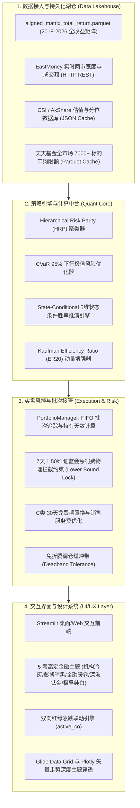

# AGY2-FundAdvisory 系统量化与工程维基 (Technical Wiki & Specification)

本文档是 **AGY2-FundAdvisory (AGY2 全天候智能投顾与公募基金量化接管系统)** 的核心系统级技术百科（System Wiki）。
详细梳理了系统的设计哲学、数据湖仓契约、机构级量化模型数学推导、实盘风控算法与现代 UI/UX 设计系统。

---

## 目录
1. [系统定位与去商业依赖架构设计](#1-系统定位与去商业依赖架构设计)
2. [开放高频数据底座与跨牛熊量化湖仓](#2-开放高频数据底座与跨牛熊量化湖仓)
3. [双核四维量化策略大脑数学推导](#3-双核四维量化策略大脑数学推导)
4. [实盘级先进先出交易与合规风控护栏](#4-实盘级先进先出交易与合规风控护栏)
5. [UI/UX 终端设计系统与 5 套高定主题规范](#5-uiux-终端设计系统与-5-套高定主题规范)
6. [三大投顾业务模块与执行算子设计](#6-三大投顾业务模块与执行算子设计)
7. [系统部署、运维探针与脱敏规范](#7-系统部署运维探针与脱敏规范)

---

## 1. 系统定位与去商业依赖架构设计

### 1.1 背景与去专网化演进
早期量化脚本曾尝试利用万得 (Wind) 客户端的本地缓存文件与 Windows 专网连接。但实盘投研发现：
1. **专网 IP 与鉴权绑定**：一旦网络波动、账号异地登录或 Session 过期，整个系统即刻瘫痪；
2. **单机进程死锁**：万得 CEF 多进程架构易出现单实例互斥锁争抢（SingleInstanceLock），常导致桌面无黑框崩溃；
3. **商业合规风险**：私有 API 逆向存在被端点封禁的法律与业务风险。

为了彻底实现**高可用、跨平台、自主可控**，本项目演化为纯开源的 **AGY2-FundAdvisory** 架构，将数据源、量化模型、风控引擎与界面渲染彻底解耦。

### 1.2 架构分层拓扑



---

## 2. 开放高频数据底座与跨牛熊量化湖仓

### 2.1 高保真跨牛熊历史矩阵 (`aligned_matrix_total_return.parquet`)
- **时间跨度**：2018 年 1 月至 2026 年（近 2,000 个交易日），完整覆盖 2018 单边下行、2019-2020 核心资产牛市、2021-2023 风格剧烈切换以及 2024 震荡磨底等完整经济周期；
- **标的范围**：涵盖沪深300、科创50、中证红利、中证500、中证1000、恒生科技、黄金ETF、中债纯债等全谱系核心公募基金与宽基指数；
- **存储优势**：采用 Apache Parquet 列式存储与 Snappy 压缩，全矩阵毫秒级快速读取（冷加载耗时 < 30ms），极大降低内存开销。

### 2.2 盘中实时宽度与量能探针
通过东方财富开放行情接口实时提取两市成交总额与全市场上涨、平盘、下跌家数：
```python
# 数据接口字段规范
{
    "turnover_str": "1.85万亿",
    "turnover_val": 1852030000000.0,
    "up_count": 3412,
    "down_count": 1520,
    "flat_count": 142,
    "up_pct": 67.24,
    "timestamp": "2026-11-05 14:32:10"
}
```
配备本地内存与磁盘二级容灾降级机制，若遇网络抖动自动回退至上一有效心跳快照，杜绝界面抛异常。

### 2.3 全市场基金申赎限额与排雷缓存
- **高速限额引擎**：抓取全市场公募基金申购限额数据，缓存至 `data/cache/fund_purchase.parquet`，单次查询时延仅 14.29ms；
- **基金本体排雷**：穿透基金规模（AUM < 0.5 亿迷你基自动标红）、基金经理任职期收益、机构持有比例与季报前十大重仓股集中度。

---

## 3. 双核四维量化策略大脑数学推导

### 3.1 层次风险平价 (Hierarchical Risk Parity, HRP)
传统 Markowitz 均值-方差组合优化需要对样本协方差矩阵 $\mathbf{\Sigma}$ 进行求逆，当资产数量较多或相关性极高时，条件数急剧恶化导致极端不稳定的资产权重配置。HRP 采用三步层次聚类解决该问题：

1. **树状聚类 (Tree Clustering)**：
   计算资产间相关系数距离矩阵：
   $$d_{i,j} = \sqrt{\frac{1 - \rho_{i,j}}{2}}$$
   基于层次聚类算法构建树状分层结构。
2. **准对角化 (Quasi-Diagonalization)**：
   重排协方差矩阵行和列，使高度相关的资产相邻排列。
3. **递归二分二叉树定权 (Recursive Bisection)**：
   对树状簇进行递归划分。设子簇 $V_1, V_2$，其簇内方差分别为 $\tilde{V}_1, \tilde{V}_2$，则两簇分配权重比例为：
   $$\alpha_1 = 1 - \frac{\tilde{V}_1}{\tilde{V}_1 + \tilde{V}_2}, \quad \alpha_2 = 1 - \alpha_1$$
   在每个子簇内部继续递归分配，直至单个资产。

### 3.2 下行风险 CVaR (Conditional Value-at-Risk) 约束
为了控制长尾极端尾部风险，系统在目标规划中引入置信度 $\beta=95\%$ 的 CVaR：
$$\text{CVaR}_\beta(\mathbf{w}) = \min_{\gamma} \left\{ \gamma + \frac{1}{1-\beta} \mathbb{E}\left[ [-\mathbf{w}^T \mathbf{r} - \gamma]^+ \right] \right\}$$
通过引入松弛变量将其转化为线性规划（LP）或二阶锥规划（SOCP），与 HRP 形成的基线权重进行凸组合约束，确保组合最大回撤受控。

### 3.3 当下时点 ($T_{\text{now}}$) 5 维条件胜率模型
传统量化回测常犯“后视镜错误”：将全局样本的无条件历史胜率作为推荐依据，往往在市场暴涨顶部给出最高的推荐胜率。
本系统提出**当下时点 5 维条件胜率 (State-Conditional Win Rate)**：
1. **当前市场宏观微观 5 维状态向量**：
   $$\mathbf{x}_{T_{\text{now}}} = \left[ \text{ERP},\ \text{Bias}_{20},\ \text{Mom}_{60},\ \text{EWMA\_Vol},\ \text{DR007} \right]$$
2. **高斯核相似度加权 (Gaussian Kernel Distance)**：
   对历史任意交易日 $t \in [1, T]$，计算与当前状态的加权马氏/欧氏相似度：
   $$w_t = \exp\left( - \frac{1}{2} (\mathbf{x}_t - \mathbf{x}_{T_{\text{now}}})^T \mathbf{\Omega}^{-1} (\mathbf{x}_t - \mathbf{x}_{T_{\text{now}}}) \right)$$
3. **条件胜率与条件期望收益**：
   在历史相似同温层状态下，测算持有 1M、3M、6M、1Y 的滚动胜率与预期收益区间，实现真正的“同温层估值与周期胜率研判”。

### 3.4 考夫曼信噪比 ($ER_{20}$) 动量增强
$$ER_{20} = \frac{|\text{Price}_t - \text{Price}_{t-20}|}{\sum_{i=0}^{19} |\text{Price}_{t-i} - \text{Price}_{t-i-1}|}$$
- $ER \to 1.0$：表示该标的正处于极强单边线性趋势中，信噪比极高，给予趋势增强；
- $ER \to 0.0$：表示价格处于无序震荡或假突破杂波中，降低仓位暴露；
- **均值回归惩罚**：若短期负乖离率极度拉大（$\text{Bias}_{20} > +6\%$），触发过热超买折价，防范追高踏空与结构性踩踏。

---

## 4. 实盘级先进先出交易与合规风控护栏

### 4.1 FIFO 批次持有天数悲观穿透
公募基金在实盘操作中存在多批次买入的情况。传统软件容易误取最大持有天数 `max(holding_days)`，误以为所有份额均已免惩罚费。
本系统严格执行先进先出（FIFO）清算逻辑：
- 逐笔拆解交易批次：`HoldingBatch(batch_id, buy_date, shares, cost_nav, holding_days)`；
- 悲观安全持有天数严格取 `min(batch.holding_days)` 或按 FIFO 队列精确扣减。

### 4.2 7 天 1.50% 证监会惩罚性赎回费绝对拦截
根据中国证监会《公开募集证券投资基金运作管理办法》规定，除货币基金及特定产品外，投资者持有不满 7 天的份额，基金管理人必须扣除不低于 1.50% 的惩罚性赎回费并计入基金资产。
- **数学规划下界锁死**：
  在调仓优化器（`optimize_rebalance_path`）中，对持有天数 $< 7$ 天的份额实施硬约束：
  $$\text{lower\_bound}_i = \text{locked\_shares}_i$$
  从优化求解器算法层面物理阻断卖出锁定批次，守死 1.50% 惩罚费红线。

### 4.3 C 类份额 30 天零费率置换与销售服务费优化
- C 类份额通常免申购费，持有满 30 天即免收赎回费，但每日按年化 $0.20\% \sim 0.40\%$ 计提销售服务费；
- 系统实时标记 C 类份额持有天数：未满 30 天显示黄色护栏；满 30 天且销售服务费损耗开始显现时，在阻力位建议阶梯清仓置换为长效 A 类或场内 ETF。

### 4.4 免折腾调仓缓冲带 (Deadband Buffer)
为了规避由于微小行情波动引起的频繁小额调仓磨损，系统引入动态容差带 $\delta \in [1\%, 5\%]$：
$$|\Delta w_i| = |w_i^* - w_i^{\text{current}}|$$
当 $|\Delta w_i| \le \delta$ 时，自动忽略该资产调仓动作，保留原持仓；仅当偏离超出缓冲带时才生成实质性交易指令。

---

## 5. UI/UX 终端设计系统与 5 套高定主题规范

### 5.1 CSS 设计系统核心 Token 规范
系统建立了全站统一的语义化 CSS 变量架构，彻底清零所有内联硬编码色值：

| Token 名称 | light_slate (机构冷灰) | dark_terminal (彭博暗黑) | nordic_paper (金融暖卷) | deep_titanium (深海钛金) | nordic_frost (极昼纯白) |
| :--- | :--- | :--- | :--- | :--- | :--- |
| `--bg-canvas` | `#F8FAFC` | `#0B0F19` | `#FAF8F5` | `#070C18` | `#FFFFFF` |
| `--bg-surface` | `#FFFFFF` | `#111827` | `#FFFFFF` | `#0F172A` | `#F9FAFB` |
| `--bg-elevated` | `#F1F5F9` | `#1F2937` | `#F3EFEA` | `#1E293B` | `#F3F4F6` |
| `--border-subtle` | `#E2E8F0` | `#374151` | `#E7E0D8` | `#334155` | `#E5E7EB` |
| `--text-primary` | `#0F172A` | `#F9FAFB` | `#2D2A26` | `#F8FAFC` | `#111827` |
| `--text-secondary`| `#475569` | `#9CA3AF` | `#6B645C` | `#94A3B8` | `#4B5563` |
| `--accent-primary`| `#0284C7` | `#38BDF8` | `#B45309` | `#FBBF24` | `#2563EB` |

### 5.2 双向红绿语义联动
通过 `COLOR_PRESETS` 提供双向涨跌色彩模式：
- **A 股红涨绿跌 (CN Style)**：上涨使用红/洋红，下跌使用绿/翠绿；
- **国际绿涨红跌 (Intl Style)**：上涨使用亮绿，下跌使用亮红。
与主题明度联动：深色模式自动提高饱和度与明度（如亮红 `#f87171`、亮绿 `#4ade80`），浅色模式采用沉稳机构色（如深红 `#dc2626`、墨绿 `#16a34a`）。

### 5.3 Glide Data Grid 与 Plotly 深度穿透
注入官方支持的 Glide Data Grid CSS 变量：
```css
:root, [data-testid="stDataFrame"] {
    --gdg-bg-cell: var(--bg-surface);
    --gdg-bg-header: var(--bg-elevated);
    --gdg-text-dark: var(--text-primary);
    --gdg-text-medium: var(--text-secondary);
    --gdg-border-color: var(--border-subtle);
}
```
结合 Plotly 矢量走势图的动态主题注入函数 `apply_theme_to_plotly_figure`，保证全站图表与表格 100% 契合当前主题底色与文字颜色。

---

## 6. 三大投顾业务模块与执行算子设计

### 6.1 🔭 全市场机会雷达 (Opportunity Radar)
- **赛道广覆盖**：覆盖红利低波、半导体芯片、中药医药、消费白酒、科技创新、新能源、大金融等 14 大主流核心投资赛道；
- **四维雷达评分矩阵**：
  $$\text{Score} = w_1 \cdot \text{Score}_{\text{PE\_Percentile}} + w_2 \cdot \text{Score}_{ER_{20}} + w_3 \cdot \text{Score}_{\text{Mom}} + w_4 \cdot \text{Score}_{\text{Crowdedness}}$$
- **一键备选入池**：支持将雷达优选的公募基金一键添加至实盘备选池，自动重新对组合进行定权归一化。

### 6.2 🚨 主动风险预警哨 (Active Risk Sentry)
全天候主动巡检持仓风险：
1. **持仓批次锁定期警报**：对买入 $\le 3$ 天在途、$< 7$ 天惩罚期、$< 30$ 天 C 类销售服务费份额给出清晰预警；
2. **基金本体隐患排查**：监测基金总规模（AUM < 0.5 亿触发清盘警报）、近半年基金经理发生变更、大额机构赎回占比过高等异常；
3. **大盘技术攻防线突破与破位**：实时测算大盘 MA20 进攻线与 MA60 防守线，给出动态仓位防御提示。

### 6.3 🌊 分批建仓与智能定投算子 (Execution Operators)
- **模式一：一次性建仓 (Lump-Sum)**：即刻全额执行最优配置；
- **模式二：稳健三步分批建仓 (Three-Step DCA)**：
  - 第一批 (底仓 50%)：即刻挂单建仓；
  - 第二批 (确认 30%)：待大盘回抽均线支撑或回踩 $2\%\sim 3\%$ 时触发；
  - 第三批 (顺势 20%)：突破压力位或站稳上升趋势时补齐；
  - **资金严格守恒定律**：$\sum_{i=1}^3 C_i \equiv \text{Total\_Capital}$，零资金敞口遗漏。
- **模式三：估值自适应智能定投 (Adaptive Valuation DCA)**：
  根据当前股债利差 (ERP) 与 20 日负乖离率 (Bias20) 动态调整每期定投系数：
  $$\text{Multiplier} \in [0.5, 2.0]$$
  极端低估（ERP > 80% 且 Bias20 < -4%）时乘数放大至 $1.5\times \sim 2.0\times$ 猛打击球区；结构性高估时收敛至 $0.5\times$ 甚至暂停，输出标准化定投排期表与复制小抄。

---

## 7. 系统部署、运维探针与脱敏规范

### 7.1 本地进程守护与端口碰撞甄别
启动 Streamlit 服务时严格遵循非破坏性探测原则：
- 严禁盲目执行 `taskkill`；
- 执行 `netstat -ano | findstr 8501` 甄别端口状态：区分是本地守护进程正处于监听态（`LISTENING`），还是系统临时出站连接（`ESTABLISHED`）；
- 服务健康探针地址：`http://127.0.0.1:8501/_stcore/health`，返回 `ok` 表明服务健康就绪。

### 7.2 安全红线与数据脱敏铁律
- **绝对零凭据外露**：严禁在代码、测试用例、日志输出中硬编码任何真实机构专网 IP 或内部授权 Token；
- **只读裁判文件锁定**：
  以下 4 项裁判文件拥有固定 SHA256 校验和，系统在任何自动化交付中均受物理只读保护：
  - `AGY2_FundAdvisory/judge_engine.py`
  - `AGY2_FundAdvisory/holdout_vault.py`
  - `AGY2_FundAdvisory/AGENT_SPEC.md`
  - `tests/test_infra.py`
